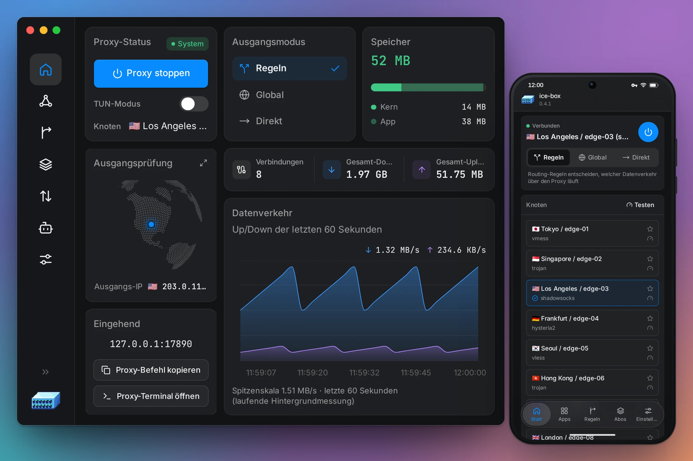

<div align="center">

<a href="https://yilong-musk.github.io/ice-box/">
  
</a>

# ice-box

**Die beste sing-box GUI.**

Schlanker Proxy-Client für macOS, Windows, Linux und Android — aufgebaut auf [sing-box](https://github.com/SagerNet/sing-box).

[](https://github.com/yilong-musk/ice-box/releases/latest)
[](https://github.com/yilong-musk/ice-box/actions/workflows/ci.yml)
[](https://github.com/yilong-musk/ice-box/releases)
[](#installation)
[](https://github.com/SagerNet/sing-box)
[](LICENSE)

[**Download**](https://github.com/yilong-musk/ice-box/releases/latest) · [**Live-Demo**](https://yilong-musk.github.io/ice-box/) · [Installation](#installation) · [CLI](#cli) · [Entwicklung](#entwicklung) · [Dokumentation](#dokumentation) · [Changelog](CHANGELOG.md)

[Bahasa Indonesia](README.id.md) · **Deutsch** · [English](README.md) · [Español](README.es.md) · [Français](README.fr.md) · [Português (BR)](README.pt-BR.md) · [Tiếng Việt](README.vi.md) · [Türkçe](README.tr.md)<br>[Русский](README.ru.md) · [Українська](README.uk.md) · [العربية](README.ar.md) · [فارسی](README.fa.md) · [日本語](README.ja.md) · [한국어](README.ko.md) · [简体中文](README.zh-CN.md) · [繁體中文](README.zh-TW.md)

<br>

<a href="https://yilong-musk.github.io/ice-box/">
  
</a>

<sub>Probiere die Desktop- und Android-Oberflächen direkt im Browser über die <a href="https://yilong-musk.github.io/ice-box/">Live-Demo</a> aus.</sub>

</div>

## Funktionen

- **Abonnements**: Erkennt sing-box JSON, Clash, Share-Links und lokale JSON-Dateien automatisch; Anzeige von Kontingent/Ablaufdatum; automatische Updates auf dem Desktop.
- **Routing & Knoten**: Modi **Regeln** / **Global** / **Direkt**, Schalter pro Regel, eigene Regeln, Latenztests und Favoriten.
- **Verkehrserfassung**: Systemproxy oder TUN auf dem Desktop ([`docs/tun.md`](docs/tun.md)); System-VPN mit App-spezifischem Routing unter Android.
- **Verbindungen & Tray (Desktop)**: Live-Verbindungsinspektor mit Suchen/Sortieren/Schließen sowie Tray-Steuerung (macOS-Menüleiste mit Geschwindigkeit & Latenztests).
- **MCP für Agenten (Desktop)**: Optionaler lokaler, authentifizierter Loopback-MCP-Server mit integrierter stdio-Bridge für dieselbe laufende Sitzung ([`docs/mcp.md`](docs/mcp.md)).
- **Grundlagen**: Bei Anmeldung starten, signierte In-App-Updates, Live-Datenverkehrs-/Speicherkarten, helles/dunkles Design und 16 Sprachen mit voller RTL-Unterstützung (`ar`, `fa`).

## Installation

Download über [GitHub Releases](https://github.com/yilong-musk/ice-box/releases/latest):

| Plattform | Voraussetzungen | Paket | Hinweise |
|---|---|---|---|
| **macOS** (Apple Silicon) | macOS 12+ | `ice-box_<version>_aarch64.dmg` | Ad-hoc-signiert: unter **Datenschutz & Sicherheit → Dennoch öffnen** erlauben oder `xattr -dr com.apple.quarantine /Applications/ice-box.app` ausführen. |
| **Windows** (x64) | Windows 10+ | `ice-box_<version>_x64-setup.exe` | Benutzerbezogener NSIS-Installer (unsigniert; SmartScreen bestätigen). TUN unterstützt nur IPv4-TCP und erfordert Administratorrechte. |
| **Linux** (x64 / arm64) | Ubuntu 22.04+ | `.AppImage` / `.deb` | `chmod +x *.AppImage` oder `sudo apt install ./ice-box_*.deb`. GNOME-Tray benötigt `gnome-shell-extension-appindicator`. |
| **Android** (arm64) | Android 14+ | `ice-box_<version>_android_arm64.apk` | Mit dem Projekt-Keystore signiert; Installation aus dieser Quelle erlauben. |

- **Schnellstart**: Abonnement importieren (**Abonnements**) → Modus & Knoten wählen (**Start** / **Knoten**) → Ein-/Aus-Schaltfläche drücken. Läuft auch ohne Abonnement im Direktmodus.
- **Updates**: Signierte In-App-Updates unter **Einstellungen → App-Updates** (`.deb` öffnet Releases für `apt`; Android lädt die APK zur Systeminstallation herunter).

## CLI

Headless-CLI und Daemon mit gebündeltem `sing-box` ([`docs/cli.md`](docs/cli.md)). Lädt das passende Release-Archiv herunter und prüft `SHA256SUMS`.

**macOS** (Apple Silicon) / **Linux** (x64 / arm64)

```bash
curl -fsSL https://raw.githubusercontent.com/yilong-musk/ice-box/main/scripts/install-cli.sh | bash
```

**Windows** (x64, PowerShell)

```powershell
irm https://raw.githubusercontent.com/yilong-musk/ice-box/main/scripts/install-cli.ps1 | iex
```

## Entwicklung

Benötigt Rust (`rust-toolchain.toml`), Node.js 22, Xcode CLT (macOS) bzw. GTK/WebKit-Entwicklungsbibliotheken (`libwebkit2gtk-4.1-dev`, `libgtk-3-dev`, `libayatana-appindicator3-dev`, `librsvg2-dev`, `libssl-dev`) unter Linux. Für Android zusätzlich JDK 17, Go und `ANDROID_HOME` (`scripts/ci-install-android-sdk.sh`).

```bash
cd apps/desktop && npm install && cd ../..
npm run fetch-singbox
npm run dev
```

| Befehl | Zweck |
|---|---|
| `npm run dev:mac-arm64` / `dev:mac-x64` / `dev:win` / `dev:linux-x64` / `dev:linux-arm64` | Für ein bestimmtes Host-Ziel ausführen |
| `npm run gate` | Vollständiges Workspace-Gate (fmt, clippy, Rust-/Frontend-Tests, Builds, Smoke-Tests) |
| `npm run fetch-singbox && npm run build` | macOS-`.dmg` bauen |
| `npm run fetch-singbox -- win && npm run build:win` | Windows-Installer bauen |
| `npm run fetch-singbox -- linux-x64 && npm run build:linux` | Linux-`.deb` & `.AppImage` bauen (`linux-arm64` auf arm64) |
| `npm run acceptance` / `acceptance:tun` / `acceptance:win` / `acceptance:linux` / `acceptance:linux-tun` | Live-Akzeptanzgates auf einem echten Host |
| `bash scripts/package-cli.sh` | Plattformübergreifendes Headless-CLI-Archiv für diesen Host bauen und prüfen |
| `bash scripts/build-android-apk.sh debug arm64` | Android-Debug-APK bauen (`amd64` für Emulator) |

```text
apps/desktop    React-Oberfläche + Tauri-Desktop-Shell (macOS, Windows, Linux)
apps/mobile     Android-Tauri-Shell (nutzt die Desktop-Oberfläche weiter)
apps/website    GitHub-Pages-Website und Live-Demo
crates/         Rust-Workspace (ice-app, ice-config, ice-core, ice-engine, ice-subscription, ice-proxy-sys, ice-tun-sys, ice-elevate, ice-helper, ice-types, ...)
```

## Dokumentation

| Dokument | Bereich |
|---|---|
| [`docs/architecture.md`](docs/architecture.md) | Architektur, Modulgrenzen und Datenfluss |
| [`docs/cli.md`](docs/cli.md) | Plattformübergreifendes Headless-CLI, Daemon und Agenten-Automatisierung |
| [`docs/mcp.md`](docs/mcp.md) | Desktop-MCP-Einrichtung, Werkzeuge und Sicherheitsmodell |
| [`docs/tun.md`](docs/tun.md) | TUN-Erfassung, Rechteerweiterung, Wiederherstellung und Plattformgrenzen |
| [`docs/testing.md`](docs/testing.md) | Lokale/CI-Gates und manuelle Live-Tests |
| [`docs/release-process.md`](docs/release-process.md) | Versionierung, Signierung, Paketierung und Veröffentlichung |
| [`CHANGELOG.md`](CHANGELOG.md) | Versionshistorie |

Die oben aufgeführten technischen Dokumente liegen derzeit auf Englisch vor.

## Lizenz

[GPL-3.0-or-later](LICENSE). Gebündelter sing-box-Kern: [GPL-3.0-or-later](third_party/sing-box/LICENSE) mit Upstream-Namensbeschränkung. Drittanbieterhinweise: [NOTICE](NOTICE).

<div align="center">
<br>
<sub>Gebaut mit Tauri, React und sing-box.</sub>
</div>
