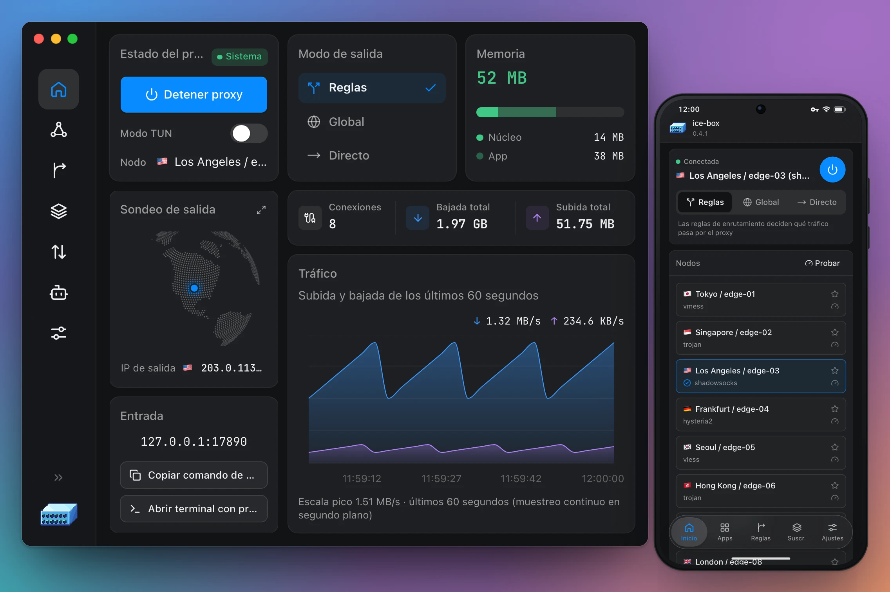

<div align="center">

<a href="https://yilong-musk.github.io/ice-box/">
  
</a>

# ice-box

**La mejor sing-box GUI.**

Cliente proxy ligero para macOS, Windows, Linux y Android — construido sobre [sing-box](https://github.com/SagerNet/sing-box).

[](https://github.com/yilong-musk/ice-box/releases/latest)
[](https://github.com/yilong-musk/ice-box/actions/workflows/ci.yml)
[](https://github.com/yilong-musk/ice-box/releases)
[](#instalación)
[](https://github.com/SagerNet/sing-box)
[](LICENSE)

[**Descargar**](https://github.com/yilong-musk/ice-box/releases/latest) · [**Demo en vivo**](https://yilong-musk.github.io/ice-box/) · [Instalación](#instalación) · [Desarrollo](#desarrollo) · [Documentación](#documentación) · [Registro de cambios](CHANGELOG.md)

[Bahasa Indonesia](README.id.md) · [Deutsch](README.de.md) · [English](README.md) · **Español** · [Français](README.fr.md) · [Português (BR)](README.pt-BR.md) · [Tiếng Việt](README.vi.md) · [Türkçe](README.tr.md)<br>[Русский](README.ru.md) · [Українська](README.uk.md) · [العربية](README.ar.md) · [فارسی](README.fa.md) · [日本語](README.ja.md) · [한국어](README.ko.md) · [简体中文](README.zh-CN.md) · [繁體中文](README.zh-TW.md)

<br>

<a href="https://yilong-musk.github.io/ice-box/">
  
</a>

<sub>Prueba las interfaces de escritorio y Android en tu navegador con la <a href="https://yilong-musk.github.io/ice-box/">Demo en vivo</a>.</sub>

</div>

## Funciones

- **Suscripciones**: Detecta automáticamente sing-box JSON, Clash, enlaces compartidos y archivos JSON locales; muestra cuota y vencimiento; actualización automática en escritorio.
- **Enrutamiento y nodos**: Modos **Reglas** / **Global** / **Directo**, interruptores por regla, reglas personalizadas, pruebas de latencia y favoritos.
- **Captura de tráfico**: Proxy del sistema o TUN en escritorio ([`docs/tun.md`](docs/tun.md)); VPN del sistema con enrutamiento por app en Android.
- **Conexiones y bandeja (Escritorio)**: Inspector de conexiones activas con búsqueda, ordenación y cierre, además de controles en la bandeja (velocidad en vivo y pruebas de latencia en la barra de menús de macOS).
- **MCP para agentes (Escritorio)**: Servidor MCP local opcional en loopback autenticado con puente stdio integrado que comparte la sesión activa ([`docs/mcp.md`](docs/mcp.md)).
- **Esenciales**: Abrir al iniciar sesión, actualizaciones firmadas en la app, tarjetas de tráfico y memoria en tiempo real, temas claro/oscuro y 16 idiomas con soporte RTL completo (`ar`, `fa`).

## Instalación

Descarga desde [GitHub Releases](https://github.com/yilong-musk/ice-box/releases/latest):

| Plataforma | Requisitos | Paquete | Notas |
|---|---|---|---|
| **macOS** (Apple Silicon) | macOS 12+ | `ice-box_<version>_aarch64.dmg` | Firma ad-hoc: permítela en **Privacidad y seguridad → Abrir igualmente**, o ejecuta `xattr -dr com.apple.quarantine /Applications/ice-box.app`. |
| **Windows** (x64) | Windows 10+ | `ice-box_<version>_x64-setup.exe` | Instalador NSIS por usuario (sin firma; confirma en SmartScreen). TUN es solo IPv4 TCP y requiere Administrador. |
| **Linux** (x64 / arm64) | Ubuntu 22.04+ | `.AppImage` / `.deb` | `chmod +x *.AppImage` o `sudo apt install ./ice-box_*.deb`. La bandeja de GNOME requiere `gnome-shell-extension-appindicator`. |
| **Android** (arm64) | Android 14+ | `ice-box_<version>_android_arm64.apk` | Firmado con el almacén de claves del proyecto; permite instalar desde esta fuente. |

- **Inicio rápido**: Importa una suscripción (**Suscripciones**) → elige modo y nodo (**Inicio** / **Nodos**) → pulsa el botón de encendido. Funciona en modo solo directo sin suscripción.
- **Actualizaciones**: Actualizaciones firmadas en la app desde **Ajustes → Actualizaciones de la app** (`.deb` abre Releases para `apt`; Android descarga el APK para instalación del sistema).

## Desarrollo

Requiere Rust (`rust-toolchain.toml`), Node.js 22, Xcode CLT (macOS) o bibliotecas de desarrollo GTK/WebKit (`libwebkit2gtk-4.1-dev`, `libgtk-3-dev`, `libayatana-appindicator3-dev`, `librsvg2-dev`, `libssl-dev`) en Linux. Android añade JDK 17, Go y `ANDROID_HOME` (`scripts/ci-install-android-sdk.sh`).

```bash
cd apps/desktop && npm install && cd ../..
npm run fetch-singbox
npm run dev
```

| Comando | Propósito |
|---|---|
| `npm run dev:mac-arm64` / `dev:mac-x64` / `dev:win` / `dev:linux-x64` / `dev:linux-arm64` | Ejecutar para un objetivo de host específico |
| `npm run gate` | Compuerta completa del espacio de trabajo (fmt, clippy, pruebas Rust/frontend, compilaciones, pruebas de humo) |
| `npm run fetch-singbox && npm run build` | Compilar `.dmg` de macOS |
| `npm run fetch-singbox -- win && npm run build:win` | Compilar instalador de Windows |
| `npm run fetch-singbox -- linux-x64 && npm run build:linux` | Compilar `.deb` y `.AppImage` de Linux (`linux-arm64` en arm64) |
| `npm run acceptance` / `acceptance:tun` / `acceptance:win` / `acceptance:linux` / `acceptance:linux-tun` | Compuertas de aceptación en vivo en un equipo real |
| `bash scripts/build-android-apk.sh debug arm64` | Compilar APK de depuración para Android (`amd64` para emulador) |

```text
apps/desktop    Interfaz React + contenedor de escritorio Tauri (macOS, Windows, Linux)
apps/mobile     Contenedor Tauri para Android (reutiliza la interfaz de escritorio)
apps/website    Sitio de GitHub Pages y Demo en vivo
crates/         Espacio de trabajo Rust (ice-app, ice-config, ice-core, ice-engine, ice-subscription, ice-proxy-sys, ice-tun-sys, ice-elevate, ice-helper, ice-types, ...)
```

## Documentación

| Documento | Alcance |
|---|---|
| [`docs/architecture.md`](docs/architecture.md) | Arquitectura, límites de módulos y flujo de datos |
| [`docs/mcp.md`](docs/mcp.md) | Configuración de MCP en escritorio, herramientas y modelo de seguridad |
| [`docs/tun.md`](docs/tun.md) | Captura TUN, elevación, recuperación y límites por plataforma |
| [`docs/testing.md`](docs/testing.md) | Compuertas locales/CI y pruebas manuales en vivo |
| [`docs/release-process.md`](docs/release-process.md) | Versionado, firmado, empaquetado y publicación |
| [`CHANGELOG.md`](CHANGELOG.md) | Historial de versiones |

La documentación técnica anterior está disponible actualmente en inglés.

## Licencia

[GPL-3.0-or-later](LICENSE). Núcleo sing-box incluido: [GPL-3.0-or-later](third_party/sing-box/LICENSE) con restricción de denominación original. Avisos de terceros: [NOTICE](NOTICE).

<div align="center">
<br>
<sub>Construido con Tauri, React y sing-box.</sub>
</div>
