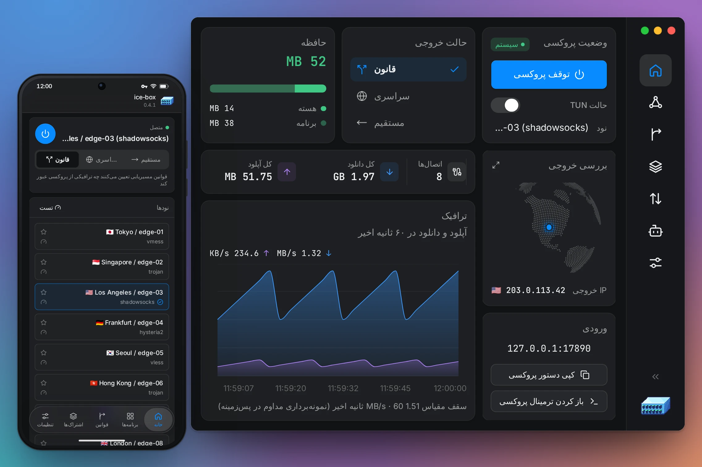

<div align="center">

<a href="https://yilong-musk.github.io/ice-box/">
  
</a>

# ice-box

**بهترین رابط گرافیکی sing-box.**

کلاینت پروکسی سبک برای macOS، Windows، Linux و Android — بر پایه هسته [sing-box](https://github.com/SagerNet/sing-box).

[](https://github.com/yilong-musk/ice-box/releases/latest)
[](https://github.com/yilong-musk/ice-box/actions/workflows/ci.yml)
[](https://github.com/yilong-musk/ice-box/releases)
[](#نصب)
[](https://github.com/SagerNet/sing-box)
[](LICENSE)

[**دانلود**](https://github.com/yilong-musk/ice-box/releases/latest) · [**دموی زنده**](https://yilong-musk.github.io/ice-box/) · [نصب](#نصب) · [توسعه](#توسعه) · [مستندات](#مستندات) · [تاریخچه تغییرات](CHANGELOG.md)

[Bahasa Indonesia](README.id.md) · [Deutsch](README.de.md) · [English](README.md) · [Español](README.es.md) · [Français](README.fr.md) · [Português (BR)](README.pt-BR.md) · [Tiếng Việt](README.vi.md) · [Türkçe](README.tr.md)<br>[Русский](README.ru.md) · [Українська](README.uk.md) · [العربية](README.ar.md) · **فارسی** · [日本語](README.ja.md) · [한국어](README.ko.md) · [简体中文](README.zh-CN.md) · [繁體中文](README.zh-TW.md)

<br>

<a href="https://yilong-musk.github.io/ice-box/">
  
</a>

<sub>رابط کاربری دسکتاپ و Android را در مرورگر از طریق <a href="https://yilong-musk.github.io/ice-box/">دموی زنده</a> امتحان کنید.</sub>

</div>

## ویژگی‌ها

- **اشتراک‌ها**: تشخیص خودکار sing-box JSON، Clash، لینک‌های اشتراک و فایل‌های JSON محلی؛ نمایش حجم و تاریخ انقضا؛ بروزرسانی خودکار در دسکتاپ.
- **مسیریابی و نودها**: حالت‌های **قانون** / **سراسری** / **مستقیم**، کلید مجزا برای هر قانون، قوانین سفارشی، تست تاخیر و برگزیده‌ها.
- **هدایت ترافیک**: پروکسی سیستم یا TUN در دسکتاپ ([`docs/tun.md`](docs/tun.md))؛ VPN سیستم با مسیریابی مجزا برای هر برنامه در Android.
- **اتصال‌ها و سینی سیستم (دسکتاپ)**: مشاهده زنده اتصال‌ها با جستجو، مرتب‌سازی و بستن، به همراه کنترل‌های سینی سیستم (سرعت زنده و تست تاخیر در نوار منوی macOS).
- **MCP برای ایجنت‌ها (دسکتاپ)**: سرور محلی اختیاری MCP با احراز هویت روی loopback و پل stdio داخلی با نشست مشترک ([`docs/mcp.md`](docs/mcp.md)).
- **امکانات پایه**: اجرا هنگام ورود به سیستم، بروزرسانی درون‌برنامه‌ای با تایید امضا، کارت‌های زنده ترافیک و حافظه، پوسته‌های روشن و تیره، و ۱۶ زبان با پشتیبانی کامل RTL (`ar`، `fa`).

## نصب

از [GitHub Releases](https://github.com/yilong-musk/ice-box/releases/latest) دانلود کنید:

| پلتفرم | پیش‌نیاز | بسته | توضیحات |
|---|---|---|---|
| **macOS** (Apple Silicon) | macOS 12+ | `ice-box_<version>_aarch64.dmg` | دارای امضای ad-hoc: از مسیر **Privacy & Security → Open Anyway** اجازه دهید یا `xattr -dr com.apple.quarantine /Applications/ice-box.app` را اجرا کنید. |
| **Windows** (x64) | Windows 10+ | `ice-box_<version>_x64-setup.exe` | نصب‌کننده NSIS ویژه کاربر (بدون امضا؛ SmartScreen را تایید کنید). حالت TUN فقط IPv4 TCP است و به Administrator نیاز دارد. |
| **Linux** (x64 / arm64) | Ubuntu 22.04+ | `.AppImage` / `.deb` | دستور `chmod +x *.AppImage` یا `sudo apt install ./ice-box_*.deb` را اجرا کنید. سینی سیستم در GNOME به `gnome-shell-extension-appindicator` نیاز دارد. |
| **Android** (arm64) | Android 14+ | `ice-box_<version>_android_arm64.apk` | با کلید پروژه (keystore) امضا شده؛ نصب از این منبع را مجاز کنید. |

- **شروع سریع**: اشتراک وارد کنید (**اشتراک‌ها**) ← حالت و نود را انتخاب کنید (**خانه** / **نودها**) ← دکمه پاور را بزنید. بدون اشتراک نیز در حالت مستقیم کار می‌کند.
- **بروزرسانی**: بروزرسانی درون‌برنامه‌ای با تایید امضا در **تنظیمات ← بروزرسانی برنامه** (نسخه `.deb` صفحه Releases را برای `apt` باز می‌کند؛ Android فایل APK را برای نصب سیستمی دانلود می‌کند).

## توسعه

پیش‌نیازها: Rust (`rust-toolchain.toml`)، Node.js 22، ابزارهای Xcode CLT (در macOS) یا کتابخانه‌های توسعه GTK/WebKit (`libwebkit2gtk-4.1-dev`، `libgtk-3-dev`، `libayatana-appindicator3-dev`، `librsvg2-dev`، `libssl-dev`) در Linux. برای Android نیز JDK 17، Go و `ANDROID_HOME` (`scripts/ci-install-android-sdk.sh`) اضافه می‌شود.

```bash
cd apps/desktop && npm install && cd ../..
npm run fetch-singbox
npm run dev
```

| دستور | کاربرد |
|---|---|
| `npm run dev:mac-arm64` / `dev:mac-x64` / `dev:win` / `dev:linux-x64` / `dev:linux-arm64` | اجرا برای یک هدف میزبان مشخص |
| `npm run gate` | گیت کامل فضای کار (fmt، clippy، تست‌های Rust و فرانت‌اند، بیلدها، تست‌های smoke) |
| `npm run fetch-singbox && npm run build` | ساخت فایل `.dmg` برای macOS |
| `npm run fetch-singbox -- win && npm run build:win` | ساخت نصب‌کننده Windows |
| `npm run fetch-singbox -- linux-x64 && npm run build:linux` | ساخت بسته‌های `.deb` و `.AppImage` برای Linux (`linux-arm64` در arm64) |
| `npm run acceptance` / `acceptance:tun` / `acceptance:win` / `acceptance:linux` / `acceptance:linux-tun` | گیت‌های پذیرش زنده روی دستگاه واقعی |
| `bash scripts/build-android-apk.sh debug arm64` | ساخت فایل APK دیباگ Android (`amd64` برای شبیه‌ساز) |

```text
apps/desktop    رابط کاربری React + پوسته دسکتاپ Tauri (macOS، Windows، Linux)
apps/mobile     پوسته Tauri برای Android (استفاده مجدد از رابط کاربری دسکتاپ)
apps/website    سایت GitHub Pages و دموی زنده
crates/         فضای کار Rust (ice-app, ice-config, ice-core, ice-engine, ice-subscription, ice-proxy-sys, ice-tun-sys, ice-elevate, ice-helper, ice-types, ...)
```

## مستندات

| سند | دامنه |
|---|---|
| [`docs/architecture.md`](docs/architecture.md) | معماری، مرزهای ماژول‌ها و جریان داده |
| [`docs/mcp.md`](docs/mcp.md) | راه‌اندازی MCP دسکتاپ، ابزارها و مدل امنیتی |
| [`docs/tun.md`](docs/tun.md) | هدایت ترافیک TUN، ارتقای دسترسی، بازیابی و محدودیت‌های پلتفرم |
| [`docs/testing.md`](docs/testing.md) | گیت‌های محلی/CI و تست‌های زنده دستی |
| [`docs/release-process.md`](docs/release-process.md) | نسخه‌گذاری، امضای دیجیتال، بسته‌بندی و انتشار |
| [`CHANGELOG.md`](CHANGELOG.md) | تاریخچه نسخه‌ها |

مستندات فنی بالا در حال حاضر به زبان انگلیسی هستند.

## مجوز

تحت مجوز [GPL-3.0-or-later](LICENSE). هسته داخلی sing-box: [GPL-3.0-or-later](third_party/sing-box/LICENSE) با محدودیت نام‌گذاری بالادستی. اعلان‌های شخص ثالث: [NOTICE](NOTICE).

<div align="center">
<br>
<sub>ساخته‌شده با Tauri، React و sing-box.</sub>
</div>
