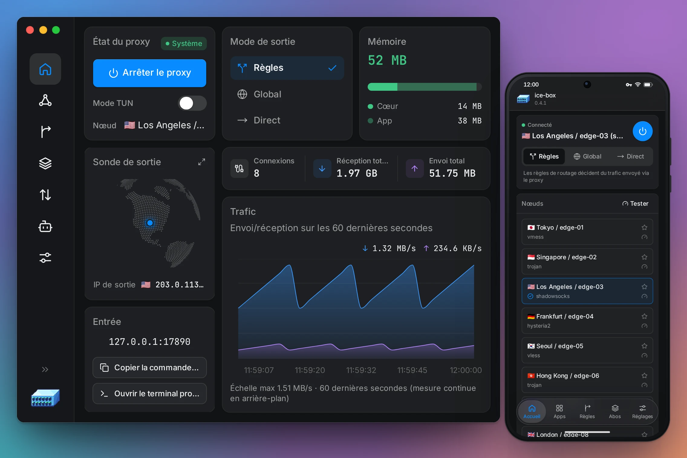

<div align="center">

<a href="https://yilong-musk.github.io/ice-box/">
  
</a>

# ice-box

**La meilleure sing-box GUI.**

Client proxy léger pour macOS, Windows, Linux et Android — basé sur [sing-box](https://github.com/SagerNet/sing-box).

[](https://github.com/yilong-musk/ice-box/releases/latest)
[](https://github.com/yilong-musk/ice-box/actions/workflows/ci.yml)
[](https://github.com/yilong-musk/ice-box/releases)
[](#installation)
[](https://github.com/SagerNet/sing-box)
[](LICENSE)

[**Télécharger**](https://github.com/yilong-musk/ice-box/releases/latest) · [**Démo en direct**](https://yilong-musk.github.io/ice-box/) · [Installation](#installation) · [Développement](#développement) · [Documentation](#documentation) · [Notes de version](CHANGELOG.md)

[Bahasa Indonesia](README.id.md) · [Deutsch](README.de.md) · [English](README.md) · [Español](README.es.md) · **Français** · [Português (BR)](README.pt-BR.md) · [Tiếng Việt](README.vi.md) · [Türkçe](README.tr.md)<br>[Русский](README.ru.md) · [Українська](README.uk.md) · [العربية](README.ar.md) · [فارسی](README.fa.md) · [日本語](README.ja.md) · [한국어](README.ko.md) · [简体中文](README.zh-CN.md) · [繁體中文](README.zh-TW.md)

<br>

<a href="https://yilong-musk.github.io/ice-box/">
  
</a>

<sub>Essayez les interfaces bureau et Android dans votre navigateur via la <a href="https://yilong-musk.github.io/ice-box/">Démo en direct</a>.</sub>

</div>

## Fonctionnalités

- **Abonnements** : Détection automatique de sing-box JSON, Clash, liens partagés et fichiers JSON locaux ; affichage du quota et de l'expiration ; mise à jour auto sur bureau.
- **Routage et nœuds** : Modes **Règles** / **Global** / **Direct**, interrupteurs par règle, règles personnalisées, tests de latence et favoris.
- **Capture du trafic** : Proxy système ou TUN sur bureau ([`docs/tun.md`](docs/tun.md)) ; VPN système avec routage par application sur Android.
- **Connexions et barre système (Bureau)** : Inspecteur de connexions en direct (recherche/tri/fermeture) et commandes de barre système (débit et tests de latence dans la barre des menus macOS).
- **MCP pour les Agents (Bureau)** : Serveur MCP local optionnel authentifié sur loopback avec pont stdio intégré partageant la session active ([`docs/mcp.md`](docs/mcp.md)).
- **L'essentiel** : Lancer à l'ouverture de session, mises à jour signées intégrées, cartes de trafic et mémoire en direct, thèmes clair/sombre et 16 langues avec prise en charge RTL complète (`ar`, `fa`).

## Installation

Téléchargez depuis [GitHub Releases](https://github.com/yilong-musk/ice-box/releases/latest) :

| Plateforme | Prérequis | Paquet | Notes |
|---|---|---|---|
| **macOS** (Apple Silicon) | macOS 12+ | `ice-box_<version>_aarch64.dmg` | Signature ad-hoc : autorisez dans **Confidentialité et sécurité → Ouvrir quand même**, ou exécutez `xattr -dr com.apple.quarantine /Applications/ice-box.app`. |
| **Windows** (x64) | Windows 10+ | `ice-box_<version>_x64-setup.exe` | Installeur NSIS par utilisateur (non signé ; confirmez SmartScreen). TUN gère uniquement IPv4 TCP et requiert un compte Administrateur. |
| **Linux** (x64 / arm64) | Ubuntu 22.04+ | `.AppImage` / `.deb` | `chmod +x *.AppImage` ou `sudo apt install ./ice-box_*.deb`. La barre système GNOME nécessite `gnome-shell-extension-appindicator`. |
| **Android** (arm64) | Android 14+ | `ice-box_<version>_android_arm64.apk` | Signé avec le keystore du projet ; autorisez l'installation depuis cette source. |

- **Démarrage rapide** : Importez un abonnement (**Abonnements**) → choisissez mode et nœud (**Accueil** / **Nœuds**) → appuyez sur le bouton d'alimentation. Fonctionne en mode direct sans abonnement.
- **Mises à jour** : Mises à jour signées intégrées dans **Réglages → Mises à jour** (`.deb` ouvre Releases pour `apt` ; Android télécharge l'APK pour l'installeur système).

## Développement

Requiert Rust (`rust-toolchain.toml`), Node.js 22, Xcode CLT (macOS) ou les bibliothèques de développement GTK/WebKit (`libwebkit2gtk-4.1-dev`, `libgtk-3-dev`, `libayatana-appindicator3-dev`, `librsvg2-dev`, `libssl-dev`) sous Linux. Android ajoute JDK 17, Go et `ANDROID_HOME` (`scripts/ci-install-android-sdk.sh`).

```bash
cd apps/desktop && npm install && cd ../..
npm run fetch-singbox
npm run dev
```

| Commande | Objectif |
|---|---|
| `npm run dev:mac-arm64` / `dev:mac-x64` / `dev:win` / `dev:linux-x64` / `dev:linux-arm64` | Lancer pour une cible hôte spécifique |
| `npm run gate` | Porte complète de l'espace de travail (fmt, clippy, tests Rust/frontend, builds, tests smoke) |
| `npm run fetch-singbox && npm run build` | Construire le `.dmg` macOS |
| `npm run fetch-singbox -- win && npm run build:win` | Construire l'installeur Windows |
| `npm run fetch-singbox -- linux-x64 && npm run build:linux` | Construire `.deb` et `.AppImage` Linux (`linux-arm64` sur arm64) |
| `npm run acceptance` / `acceptance:tun` / `acceptance:win` / `acceptance:linux` / `acceptance:linux-tun` | Portes d'acceptation sur machine réelle |
| `bash scripts/build-android-apk.sh debug arm64` | Construire l'APK Android de débogage (`amd64` pour l'émulateur) |

```text
apps/desktop    Interface React + coque Tauri bureau (macOS, Windows, Linux)
apps/mobile     Coque Tauri Android (réutilise l'interface bureau)
apps/website    Site GitHub Pages et Démo en direct
crates/         Espace de travail Rust (ice-app, ice-config, ice-core, ice-engine, ice-subscription, ice-proxy-sys, ice-tun-sys, ice-elevate, ice-helper, ice-types, ...)
```

## Documentation

| Document | Contenu |
|---|---|
| [`docs/architecture.md`](docs/architecture.md) | Architecture, limites des modules et flux de données |
| [`docs/mcp.md`](docs/mcp.md) | Configuration MCP bureau, outils et modèle de sécurité |
| [`docs/tun.md`](docs/tun.md) | Capture TUN, élévation, récupération et limites par plateforme |
| [`docs/testing.md`](docs/testing.md) | Portes locales/CI et tests manuels en conditions réelles |
| [`docs/release-process.md`](docs/release-process.md) | Gestion des versions, signature, empaquetage et publication |
| [`CHANGELOG.md`](CHANGELOG.md) | Historique des versions |

Ces documents techniques sont actuellement rédigés en anglais.

## Licence

[GPL-3.0-or-later](LICENSE). Cœur sing-box embarqué : [GPL-3.0-or-later](third_party/sing-box/LICENSE) avec sa restriction de nommage en amont. Mentions tierces : [NOTICE](NOTICE).

<div align="center">
<br>
<sub>Construit avec Tauri, React et sing-box.</sub>
</div>
