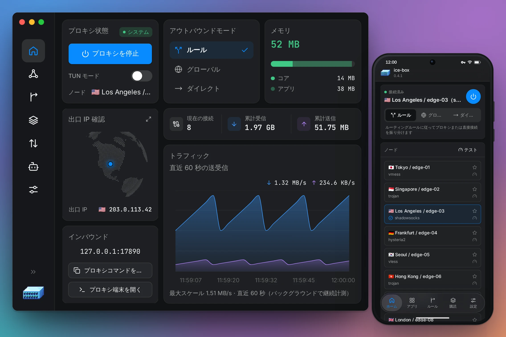

<div align="center">

<a href="https://yilong-musk.github.io/ice-box/">
  
</a>

# ice-box

**最高の sing-box GUI。**

macOS、Windows、Linux、Android 向けの軽量プロキシクライアント — [sing-box](https://github.com/SagerNet/sing-box) コアベース。

[](https://github.com/yilong-musk/ice-box/releases/latest)
[](https://github.com/yilong-musk/ice-box/actions/workflows/ci.yml)
[](https://github.com/yilong-musk/ice-box/releases)
[](#インストール)
[](https://github.com/SagerNet/sing-box)
[](LICENSE)

[**ダウンロード**](https://github.com/yilong-musk/ice-box/releases/latest) · [**ライブデモ**](https://yilong-musk.github.io/ice-box/) · [インストール](#インストール) · [CLI](#cli) · [開発](#開発) · [ドキュメント](#ドキュメント) · [更新履歴](CHANGELOG.md)

[Bahasa Indonesia](README.id.md) · [Deutsch](README.de.md) · [English](README.md) · [Español](README.es.md) · [Français](README.fr.md) · [Português (BR)](README.pt-BR.md) · [Tiếng Việt](README.vi.md) · [Türkçe](README.tr.md)<br>[Русский](README.ru.md) · [Українська](README.uk.md) · [العربية](README.ar.md) · [فارسی](README.fa.md) · **日本語** · [한국어](README.ko.md) · [简体中文](README.zh-CN.md) · [繁體中文](README.zh-TW.md)

<br>

<a href="https://yilong-musk.github.io/ice-box/">
  
</a>

<sub><a href="https://yilong-musk.github.io/ice-box/">ライブデモ</a>からブラウザ上でデスクトップ版と Android 版の UI を試せます。</sub>

</div>

## 機能

- **サブスクリプション**：sing-box JSON、Clash、共有リンク、ローカル JSON ファイルを自動判別。残容量・有効期限の表示、デスクトップでの自動更新に対応。
- **ルーティングとノード**：**ルール** / **グローバル** / **ダイレクト** の各モード、ルール単位のオン／オフ、カスタムルール、遅延テスト、お気に入り登録。
- **トラフィックキャプチャ**：デスクトップではシステムプロキシまたは TUN（[`docs/tun.md`](docs/tun.md)）、Android ではアプリ別ルーティング対応のシステム VPN。
- **接続とトレイ（デスクトップ）**：検索・並び替え・切断対応のリアルタイム接続インスペクタとトレイ操作（macOS メニューバーでの速度表示・遅延テスト対応）。
- **Agent 向け MCP（デスクトップ）**：実行中セッションを共有する、オプトインのローカルループバック認証付き MCP サーバーと内蔵 stdio ブリッジ（[`docs/mcp.md`](docs/mcp.md)）。
- **基本機能**：ログイン時に自動起動、署名検証済みのアプリ内更新、リアルタイムのトラフィック／メモリ表示、ライト／ダークテーマ、完全な RTL（`ar`、`fa`）を含む 16 言語対応。

## インストール

[GitHub Releases](https://github.com/yilong-musk/ice-box/releases/latest) からダウンロード：

| プラットフォーム | 動作要件 | パッケージ | 備考 |
|---|---|---|---|
| **macOS**（Apple Silicon） | macOS 12+ | `ice-box_<version>_aarch64.dmg` | ad-hoc 署名：**プライバシーとセキュリティ → このまま開く** で許可するか、`xattr -dr com.apple.quarantine /Applications/ice-box.app` を実行。 |
| **Windows**（x64） | Windows 10+ | `ice-box_<version>_x64-setup.exe` | ユーザー単位の NSIS インストーラー（未署名、SmartScreen で要確認）。TUN は IPv4 TCP のみで管理者権限が必要。 |
| **Linux**（x64 / arm64） | Ubuntu 22.04+ | `.AppImage` / `.deb` | `chmod +x *.AppImage` または `sudo apt install ./ice-box_*.deb`。GNOME トレイには `gnome-shell-extension-appindicator` が必要。 |
| **Android**（arm64） | Android 14+ | `ice-box_<version>_android_arm64.apk` | プロジェクトキーストア署名。この提供元からのインストールを許可してください。 |

- **クイックスタート**：**サブスクリプション** をインポート → **ホーム** / **ノード** でモードとノードを選択 → 電源ボタンを押す。サブスクリプションなしでもダイレクトモードで動作します。
- **アップデート**：**設定 → アプリの更新** から署名検証済みアップデートをインストール（`.deb` は `apt` 用に Releases ページを開き、Android は APK をダウンロードしてシステムインストーラーへ引き継ぎます）。

## CLI

`sing-box` 同梱のヘッドレス CLI・デーモン（[`docs/cli.md`](docs/cli.md)）。対応するリリースアーカイブをダウンロードし `SHA256SUMS` を検証します。

**macOS**（Apple Silicon）/ **Linux**（x64 / arm64）

```bash
curl -fsSL https://raw.githubusercontent.com/yilong-musk/ice-box/main/scripts/install-cli.sh | bash
```

**Windows**（x64、PowerShell）

```powershell
irm https://raw.githubusercontent.com/yilong-musk/ice-box/main/scripts/install-cli.ps1 | iex
```

## 開発

必要環境：Rust（`rust-toolchain.toml`）、Node.js 22、Xcode CLT（macOS）、または Linux 向け GTK/WebKit 開発ライブラリ（`libwebkit2gtk-4.1-dev`、`libgtk-3-dev`、`libayatana-appindicator3-dev`、`librsvg2-dev`、`libssl-dev`）。Android ビルドにはさらに JDK 17、Go、`ANDROID_HOME`（`scripts/ci-install-android-sdk.sh`）が必要です。

```bash
cd apps/desktop && npm install && cd ../..
npm run fetch-singbox
npm run dev
```

| コマンド | 用途 |
|---|---|
| `npm run dev:mac-arm64` / `dev:mac-x64` / `dev:win` / `dev:linux-x64` / `dev:linux-arm64` | 指定したホストターゲット向けに実行 |
| `npm run gate` | ワークスペース全体のゲート（fmt、clippy、Rust／フロントエンドテスト、ビルド、スモークテスト） |
| `npm run fetch-singbox && npm run build` | macOS `.dmg` をビルド |
| `npm run fetch-singbox -- win && npm run build:win` | Windows インストーラーをビルド |
| `npm run fetch-singbox -- linux-x64 && npm run build:linux` | Linux `.deb`・`.AppImage` をビルド（arm64 では `linux-arm64`） |
| `npm run acceptance` / `acceptance:tun` / `acceptance:win` / `acceptance:linux` / `acceptance:linux-tun` | 実ホストでの受け入れゲート |
| `bash scripts/package-cli.sh` | このホスト向けのクロスプラットフォーム CLI アーカイブをビルド・検証 |
| `bash scripts/build-android-apk.sh debug arm64` | Android デバッグ APK をビルド（エミュレーター向けは `amd64`） |

```text
apps/desktop    React UI + Tauri デスクトップシェル（macOS、Windows、Linux）
apps/mobile     Android Tauri シェル（デスクトップ UI を再利用）
apps/website    GitHub Pages サイトおよびライブデモ
crates/         Rust ワークスペース（ice-app, ice-config, ice-core, ice-engine, ice-subscription, ice-proxy-sys, ice-tun-sys, ice-elevate, ice-helper, ice-types, ...）
```

## ドキュメント

| ドキュメント | 対象範囲 |
|---|---|
| [`docs/architecture.md`](docs/architecture.md) | アーキテクチャ、モジュール境界、データフロー |
| [`docs/cli.md`](docs/cli.md) | クロスプラットフォームのヘッドレス CLI・デーモン・Agent 自動化 |
| [`docs/mcp.md`](docs/mcp.md) | デスクトップ MCP のセットアップ、ツール、セキュリティモデル |
| [`docs/tun.md`](docs/tun.md) | TUN キャプチャ、権限昇格、復旧、プラットフォーム制限 |
| [`docs/testing.md`](docs/testing.md) | ローカル／CI ゲート、手動実機テスト |
| [`docs/release-process.md`](docs/release-process.md) | バージョニング、署名、パッケージング、公開手順 |
| [`CHANGELOG.md`](CHANGELOG.md) | リリース履歴 |

上記の技術ドキュメントは現在英語のみで提供されています。

## ライセンス

[GPL-3.0-or-later](LICENSE)。同梱 sing-box コア：[GPL-3.0-or-later](third_party/sing-box/LICENSE)（アップストリームの命名制限あり）。サードパーティ表記：[NOTICE](NOTICE)。

<div align="center">
<br>
<sub>Tauri、React、sing-box で構築されています。</sub>
</div>
