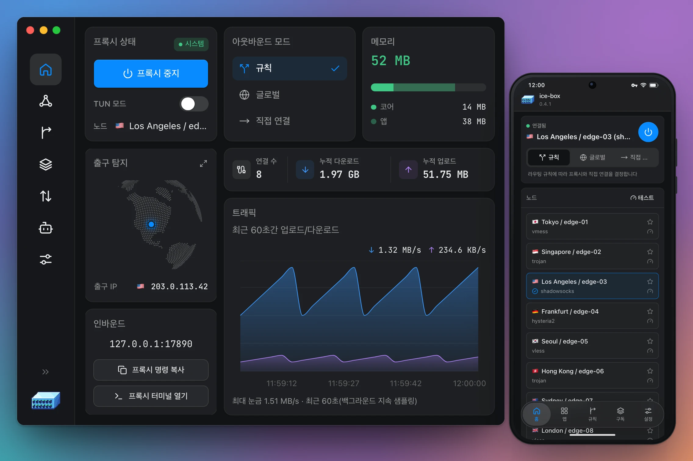

<div align="center">

<a href="https://yilong-musk.github.io/ice-box/">
  
</a>

# ice-box

**최고의 sing-box GUI.**

macOS, Windows, Linux, Android를 위한 가벼운 프록시 클라이언트 — [sing-box](https://github.com/SagerNet/sing-box) 기반.

[](https://github.com/yilong-musk/ice-box/releases/latest)
[](https://github.com/yilong-musk/ice-box/actions/workflows/ci.yml)
[](https://github.com/yilong-musk/ice-box/releases)
[](#설치)
[](https://github.com/SagerNet/sing-box)
[](LICENSE)

[**다운로드**](https://github.com/yilong-musk/ice-box/releases/latest) · [**라이브 데모**](https://yilong-musk.github.io/ice-box/) · [설치](#설치) · [개발](#개발) · [문서](#문서) · [변경 로그](CHANGELOG.md)

[Bahasa Indonesia](README.id.md) · [Deutsch](README.de.md) · [English](README.md) · [Español](README.es.md) · [Français](README.fr.md) · [Português (BR)](README.pt-BR.md) · [Tiếng Việt](README.vi.md) · [Türkçe](README.tr.md)<br>[Русский](README.ru.md) · [Українська](README.uk.md) · [العربية](README.ar.md) · [فارسی](README.fa.md) · [日本語](README.ja.md) · **한국어** · [简体中文](README.zh-CN.md) · [繁體中文](README.zh-TW.md)

<br>

<a href="https://yilong-musk.github.io/ice-box/">
  
</a>

<sub><a href="https://yilong-musk.github.io/ice-box/">라이브 데모</a>를 통해 브라우저에서 데스크톱 및 Android UI를 바로 체험해 보세요.</sub>

</div>

## 기능

- **구독**: sing-box JSON, Clash, 공유 링크, 로컬 JSON 파일 자동 인식; 트래픽/만료일 표시; 데스크톱 자동 업데이트.
- **라우팅 및 노드**: **규칙** / **글로벌** / **직접 연결** 모드, 규칙별 스위치, 사용자 지정 규칙, 지연 시간 테스트, 즐겨찾기.
- **트래픽 캡처**: 데스크톱 시스템 프록시 또는 TUN([`docs/tun.md`](docs/tun.md)); Android 앱별 라우팅 지원 시스템 VPN.
- **연결 및 트레이(데스크톱)**: 검색/정렬/종료를 지원하는 실시간 연결 탐색기와 트레이 제어(macOS 메뉴 막대 속도 표시 및 지연 시간 테스트).
- **에이전트용 MCP(데스크톱)**: 활성 세션을 공유하는 선택형 로컬 루프백 인증 MCP 서버 및 내장 stdio 브리지([`docs/mcp.md`](docs/mcp.md)).
- **기본 기능**: 로그인 시 자동 실행, 서명 검증된 인앱 업데이트, 실시간 트래픽/메모리 카드, 라이트/다크 테마, 완벽한 RTL(`ar`, `fa`) 포함 16개 언어 지원.

## 설치

[GitHub Releases](https://github.com/yilong-musk/ice-box/releases/latest)에서 다운로드:

| 플랫폼 | 요구 사항 | 패키지 | 비고 |
|---|---|---|---|
| **macOS** (Apple Silicon) | macOS 12+ | `ice-box_<version>_aarch64.dmg` | ad-hoc 서명: **개인정보 보호 및 보안 → 확인 없이 열기**에서 허용하거나 `xattr -dr com.apple.quarantine /Applications/ice-box.app` 실행. |
| **Windows** (x64) | Windows 10+ | `ice-box_<version>_x64-setup.exe` | 사용자별 NSIS 설치 파일(미서명, SmartScreen 확인 필요). TUN은 IPv4 TCP 전용이며 관리자 권한 필요. |
| **Linux** (x64 / arm64) | Ubuntu 22.04+ | `.AppImage` / `.deb` | `chmod +x *.AppImage` 또는 `sudo apt install ./ice-box_*.deb`. GNOME 트레이는 `gnome-shell-extension-appindicator` 필요. |
| **Android** (arm64) | Android 14+ | `ice-box_<version>_android_arm64.apk` | 프로젝트 키스토어 서명; 이 출처의 앱 설치 허용 필요. |

- **빠른 시작**: **구독** 가져오기 → **홈** / **노드**에서 모드와 노드 선택 → 전원 버튼 클릭. 구독 없이도 직접 연결 모드로 동작합니다.
- **업데이트**: **설정 → 앱 업데이트**에서 서명 검증된 인앱 업데이트 설치(`.deb`는 `apt` 관리를 위해 Releases 페이지 열기; Android는 APK 다운로드 후 시스템 설치).

## 개발

Rust(`rust-toolchain.toml`), Node.js 22, Xcode CLT(macOS) 또는 Linux용 GTK/WebKit 개발 라이브러리(`libwebkit2gtk-4.1-dev`, `libgtk-3-dev`, `libayatana-appindicator3-dev`, `librsvg2-dev`, `libssl-dev`)가 필요합니다. Android 빌드에는 JDK 17, Go, `ANDROID_HOME`(`scripts/ci-install-android-sdk.sh`)이 추가로 필요합니다.

```bash
cd apps/desktop && npm install && cd ../..
npm run fetch-singbox
npm run dev
```

| 명령 | 용도 |
|---|---|
| `npm run dev:mac-arm64` / `dev:mac-x64` / `dev:win` / `dev:linux-x64` / `dev:linux-arm64` | 특정 호스트 타깃으로 실행 |
| `npm run gate` | 전체 워크스페이스 게이트(fmt, clippy, Rust/프론트엔드 테스트, 빌드, 스모크 테스트) |
| `npm run fetch-singbox && npm run build` | macOS `.dmg` 빌드 |
| `npm run fetch-singbox -- win && npm run build:win` | Windows 설치 파일 빌드 |
| `npm run fetch-singbox -- linux-x64 && npm run build:linux` | Linux `.deb` 및 `.AppImage` 빌드(arm64는 `linux-arm64`) |
| `npm run acceptance` / `acceptance:tun` / `acceptance:win` / `acceptance:linux` / `acceptance:linux-tun` | 실제 호스트 인수 테스트 게이트 |
| `bash scripts/build-android-apk.sh debug arm64` | Android 디버그 APK 빌드(에뮬레이터는 `amd64`) |

```text
apps/desktop    React UI + Tauri 데스크톱 셸 (macOS, Windows, Linux)
apps/mobile     Android Tauri 셸 (데스크톱 UI 재사용)
apps/website    GitHub Pages 사이트 및 라이브 데모
crates/         Rust 워크스페이스 (ice-app, ice-config, ice-core, ice-engine, ice-subscription, ice-proxy-sys, ice-tun-sys, ice-elevate, ice-helper, ice-types, ...)
```

## 문서

| 문서 | 범위 |
|---|---|
| [`docs/architecture.md`](docs/architecture.md) | 아키텍처, 모듈 경계 및 데이터 흐름 |
| [`docs/mcp.md`](docs/mcp.md) | 데스크톱 MCP 설정, 도구 및 보안 모델 |
| [`docs/tun.md`](docs/tun.md) | TUN 캡처, 권한 상승, 복구 및 플랫폼 제한 사항 |
| [`docs/testing.md`](docs/testing.md) | 로컬/CI 게이트 및 수동 실기기 테스트 |
| [`docs/release-process.md`](docs/release-process.md) | 버전 관리, 서명, 패키징 및 배포 |
| [`CHANGELOG.md`](CHANGELOG.md) | 릴리스 기록 |

위 기술 문서는 현재 영어로만 제공됩니다.

## 라이선스

[GPL-3.0-or-later](LICENSE). 번들된 sing-box 코어: [GPL-3.0-or-later](third_party/sing-box/LICENSE)(업스트림 명칭 제한 포함). 서드파티 고지: [NOTICE](NOTICE).

<div align="center">
<br>
<sub>Tauri, React, sing-box로 제작되었습니다.</sub>
</div>
