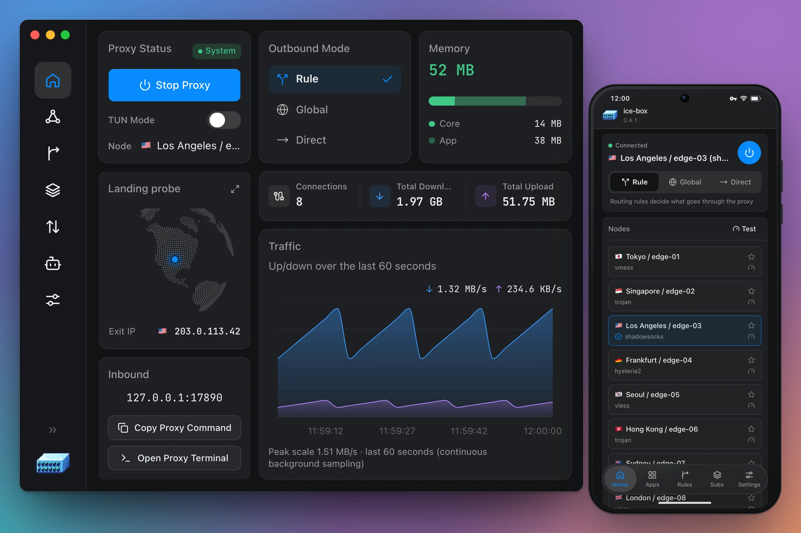

<div align="center">

<a href="https://yilong-musk.github.io/ice-box/">
  
</a>

# ice-box

**The best sing-box GUI.**

Lightweight proxy client for macOS, Windows, Linux, and Android — built on [sing-box](https://github.com/SagerNet/sing-box).

[](https://github.com/yilong-musk/ice-box/releases/latest)
[](https://github.com/yilong-musk/ice-box/actions/workflows/ci.yml)
[](https://github.com/yilong-musk/ice-box/releases)
[](#install)
[](https://github.com/SagerNet/sing-box)
[](LICENSE)

[**Download**](https://github.com/yilong-musk/ice-box/releases/latest) · [**Live Demo**](https://yilong-musk.github.io/ice-box/) · [Install](#install) · [Development](#development) · [Docs](#docs) · [Changelog](CHANGELOG.md)

[Bahasa Indonesia](README.id.md) · [Deutsch](README.de.md) · **English** · [Español](README.es.md) · [Français](README.fr.md) · [Português (BR)](README.pt-BR.md) · [Tiếng Việt](README.vi.md) · [Türkçe](README.tr.md)<br>[Русский](README.ru.md) · [Українська](README.uk.md) · [العربية](README.ar.md) · [فارسی](README.fa.md) · [日本語](README.ja.md) · [한국어](README.ko.md) · [简体中文](README.zh-CN.md) · [繁體中文](README.zh-TW.md)

<br>

<a href="https://yilong-musk.github.io/ice-box/">
  
</a>

<sub>Try the desktop and Android UIs in your browser via the <a href="https://yilong-musk.github.io/ice-box/">Live Demo</a>.</sub>

</div>

## Features

- **Subscriptions**: Auto-detects sing-box JSON, Clash, share links, and local JSON files; quota/expiry display; desktop auto-update.
- **Routing & Nodes**: **Rule** / **Global** / **Direct** modes, per-rule switches, custom rules, latency tests, and favorites.
- **Traffic Capture**: System proxy or TUN on desktop ([`docs/tun.md`](docs/tun.md)); system VPN with per-app routing on Android.
- **Connections & Tray (Desktop)**: Live connection inspector with search/sort/close, plus tray controls (macOS menu-bar speed & delay tests).
- **MCP for Agents (Desktop)**: Opt-in local authenticated loopback MCP server with built-in stdio bridge sharing the live session ([`docs/mcp.md`](docs/mcp.md)).
- **Essentials**: Launch at login, signed in-app updates, live traffic/memory cards, light/dark themes, and 16 languages with full RTL (`ar`, `fa`).

## Install

Download from [GitHub Releases](https://github.com/yilong-musk/ice-box/releases/latest):

| Platform | Requires | Package | Notes |
|---|---|---|---|
| **macOS** (Apple Silicon) | macOS 12+ | `ice-box_<version>_aarch64.dmg` | Ad-hoc signed: allow in **Privacy & Security → Open Anyway**, or run `xattr -dr com.apple.quarantine /Applications/ice-box.app`. |
| **Windows** (x64) | Windows 10+ | `ice-box_<version>_x64-setup.exe` | Per-user NSIS installer (unsigned; confirm SmartScreen). TUN is IPv4 TCP only and requires Administrator. |
| **Linux** (x64 / arm64) | Ubuntu 22.04+ | `.AppImage` / `.deb` | `chmod +x *.AppImage` or `sudo apt install ./ice-box_*.deb`. GNOME tray needs `gnome-shell-extension-appindicator`. |
| **Android** (arm64) | Android 14+ | `ice-box_<version>_android_arm64.apk` | Signed with the project keystore; allow installing from this source. |
| **CLI** (macOS / Windows / Linux) | macOS 12+ / Win 10+ / Ubuntu 22.04+ | `ice-box-cli_<version>_<os>_<arch>.tar.gz` / `.zip` | Headless CLI & daemon with bundled `sing-box` ([`docs/cli.md`](docs/cli.md)). |

**CLI one-line install** (downloads the matching release archive and verifies `SHA256SUMS`):

**macOS** (Apple Silicon) / **Linux** (x64 / arm64)

```bash
curl -fsSL https://raw.githubusercontent.com/yilong-musk/ice-box/main/scripts/install-cli.sh | bash
```

**Windows** (x64, PowerShell)

```powershell
irm https://raw.githubusercontent.com/yilong-musk/ice-box/main/scripts/install-cli.ps1 | iex
```

- **Quick start**: Import a subscription (**Subscriptions**) → pick mode & node (**Home** / **Nodes**) → press power. Works in direct mode without a subscription.
- **Updates**: Signed in-app updates in **Settings → App Updates** (`.deb` opens Releases for `apt`; Android downloads APK for system install).

## Development

Requires Rust (`rust-toolchain.toml`), Node.js 22, Xcode CLT (macOS), or GTK/WebKit dev libs (`libwebkit2gtk-4.1-dev`, `libgtk-3-dev`, `libayatana-appindicator3-dev`, `librsvg2-dev`, `libssl-dev`) on Linux. Android adds JDK 17, Go, and `ANDROID_HOME` (`scripts/ci-install-android-sdk.sh`).

```bash
cd apps/desktop && npm install && cd ../..
npm run fetch-singbox
npm run dev
```

| Command | Purpose |
|---|---|
| `npm run dev:mac-arm64` / `dev:mac-x64` / `dev:win` / `dev:linux-x64` / `dev:linux-arm64` | Run for a specific host target |
| `npm run gate` | Full workspace gate (fmt, clippy, Rust/frontend tests, builds, smoke tests) |
| `npm run fetch-singbox && npm run build` | Build macOS `.dmg` |
| `npm run fetch-singbox -- win && npm run build:win` | Build Windows installer |
| `npm run fetch-singbox -- linux-x64 && npm run build:linux` | Build Linux `.deb` & `.AppImage` (`linux-arm64` on arm64) |
| `npm run acceptance` / `acceptance:tun` / `acceptance:win` / `acceptance:linux` / `acceptance:linux-tun` | Live host acceptance gates |
| `bash scripts/package-cli.sh` | Build and verify the cross-platform headless CLI archive for this host |
| `bash scripts/build-android-apk.sh debug arm64` | Build Android debug APK (`amd64` for emulator) |

```text
apps/desktop    React UI + Tauri desktop shell (macOS, Windows, Linux)
apps/mobile     Android Tauri shell (reuses desktop UI)
apps/website    GitHub Pages site and Live Demo
crates/         Rust workspace (ice-app, ice-config, ice-core, ice-engine, ice-subscription, ice-proxy-sys, ice-tun-sys, ice-elevate, ice-helper, ice-types, ...)
```

## Docs

| Document | Scope |
|---|---|
| [`docs/architecture.md`](docs/architecture.md) | Architecture, module boundaries, and data flow |
| [`docs/cli.md`](docs/cli.md) | Cross-platform headless CLI, daemon, and Agent automation |
| [`docs/mcp.md`](docs/mcp.md) | Desktop MCP setup, tools, and security model |
| [`docs/tun.md`](docs/tun.md) | TUN capture, elevation, recovery, and platform limits |
| [`docs/testing.md`](docs/testing.md) | Local/CI gates and manual live tests |
| [`docs/release-process.md`](docs/release-process.md) | Versioning, signing, packaging, and publishing |
| [`CHANGELOG.md`](CHANGELOG.md) | Release history |

## License

[GPL-3.0-or-later](LICENSE). Bundled sing-box core: [GPL-3.0-or-later](third_party/sing-box/LICENSE) with upstream naming restriction. Third-party notices: [NOTICE](NOTICE).

<div align="center">
<br>
<sub>Built with Tauri, React, and sing-box.</sub>
</div>
