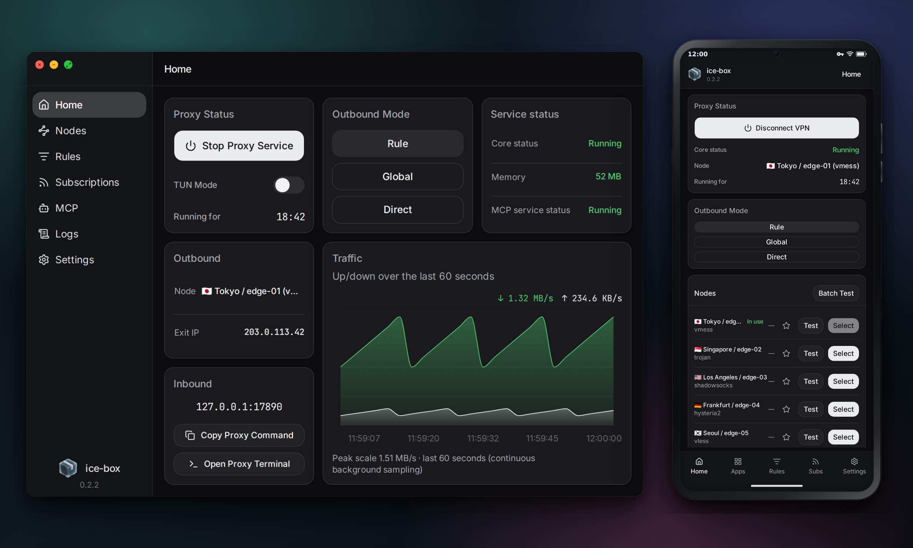

<div align="center">

<a href="https://yilong-musk.github.io/ice-box/">
  
</a>

# ice-box

**Proxy, kept simple.**

A lightweight proxy client for macOS, Windows, and Android.<br>
Easy to set up, quick to start, quiet once it runs, and agent-friendly — built on a [sing-box](https://github.com/SagerNet/sing-box) core.

[](https://github.com/yilong-musk/ice-box/releases/latest)
[](https://github.com/yilong-musk/ice-box/actions/workflows/ci.yml)
[](https://github.com/yilong-musk/ice-box/releases)
[](#install)
[](https://github.com/SagerNet/sing-box)
[](LICENSE)

[**Download**](https://github.com/yilong-musk/ice-box/releases/latest) · [**Live Demo**](https://yilong-musk.github.io/ice-box/) · [Install](#install) · [TUN](#tun-mode) · [Docs](#documentation) · [Changelog](CHANGELOG.md)

English · [简体中文](README.zh-CN.md)

<br>

<a href="https://yilong-musk.github.io/ice-box/">
  
</a>

<sub>The <a href="https://yilong-musk.github.io/ice-box/">Live Demo</a> runs the desktop and Android UIs in your browser against a simulated backend.</sub>

</div>

## Install

Grab the installer for your platform from the [latest release](https://github.com/yilong-musk/ice-box/releases/latest).

| Platform | Installer | First launch |
|---|---|---|
| **macOS** (Apple Silicon) | `ice-box_<version>_aarch64.dmg` | Ad-hoc signed only (no Developer ID, not notarized), so the first launch shows an **unidentified developer** warning. Allow it in **System Settings → Privacy & Security → Open Anyway** (macOS 15+), right-click **Open** (older versions), or run `xattr -dr com.apple.quarantine /Applications/ice-box.app`. |
| **Windows** (x64) | `ice-box_<version>_x64-setup.exe` | Per-user NSIS installer; no administrator rights required. It has no Authenticode signature, so SmartScreen may ask you to confirm. |
| **Android** (arm64) | `ice-box_<version>_android_arm64.apk` | Signed with the project keystore. There is no Google Play listing; Android asks for permission to install from this source. |

**Updating.** On macOS and Windows (0.1.5+), ice-box checks GitHub Releases in the background and installs signature-verified updates from **Settings → App Updates**; older installs need one manual upgrade first. On Android, **Settings → App Updates** checks the same catalog, downloads the arm64 APK, and hands it to the system installer for confirmation.

## Quick start

1. **Import a subscription.** Open **Subscriptions**, paste the URL, and press **Import**. sing-box JSON, Clash, and share-link lists are detected automatically. Desktop can auto-update profiles; Android refreshes only on import or manual refresh. Provider traffic and expiry from list entries or the `subscription-userinfo` header are summarized on the subscription line.
2. **Pick a mode and a node.** On **Home**, choose **Rule**, **Global**, or **Direct**. On desktop, open **Nodes** to pick an exit and test its latency; on Android, use the node list on **Home**.
3. **Start the proxy service.** Press the power button. Desktop applies the system proxy or starts TUN when enabled; Android connects the VPN after the system permission prompt.

No subscription yet? ice-box starts in direct-only mode, so the core, capture, and UI can be explored before importing anything.

## Launch at login

On macOS and Windows, enable **Settings → Startup → Launch at login**. A login start stays in the tray with the window hidden, starts the core, and restores the last proxy state.

The entry is registered per user — a LaunchAgent plist under `~/Library/LaunchAgents` on macOS, an `HKCU` `Run` value on Windows — and re-pointed at the installed app on every launch. macOS 13+ also lists it under **System Settings → General → Login Items**; the in-app switch stays authoritative, so turning the entry off there does not clear it. Running straight from the disk image is refused because that path disappears after reboot.

Android has no login item. **Settings → System** explains battery-optimization exemption, strict Private DNS, and always-on VPN.

## TUN mode

On macOS and Windows, TUN captures traffic at the network layer, covering apps that never read the system proxy. See [`docs/tun.md`](docs/tun.md) for setup, switch behavior, platform coverage, and limitations. Android uses the system VPN; see [`docs/architecture.md`](docs/architecture.md#clients).

## Agent access with MCP

The macOS and Windows app exposes an opt-in local MCP service. Open **MCP** above **Logs** and **Settings**, enable it, and copy the generated client configuration. The Agent shares the running session's settings, subscriptions, data, core, and proxy state instead of starting another runtime.

- **35 tools.** Status, settings, traffic, subscriptions, nodes and groups, rules, logs, diagnostics, proxy control, and protected TUN recovery. Results carry structured content when available and preserve application error codes.
- **Safe by default.** MCP listens only on authenticated loopback with a random control token that is never included in the copied client config.
- **Built-in stdio bridge.** The generated config launches the same executable in bridge mode, so no separate daemon or protocol adapter is needed.

MCP is desktop-only: Android has no MCP, and the website demo uses a simulated service. See [`docs/mcp.md`](docs/mcp.md) for setup, lifecycle, and security boundaries.

## Development

Rust (stable), Node.js 22, and the Xcode Command Line Tools on macOS. Android builds also need JDK 17, Go, and an Android SDK (`ANDROID_HOME`) with the packages installed by `scripts/ci-install-android-sdk.sh`.

```bash
cd apps/desktop && npm install && cd ../..
npm run fetch-singbox   # download the pinned sing-box core for this host
npm run dev
```

| Command | Purpose |
|---|---|
| `npm run dev:mac-arm64` / `dev:mac-x64` / `dev:win` | Run against a specific host target |
| `npm run gate` | Full workspace gate: fmt, clippy, Rust tests, typechecks, builds, smoke tests, fixtures |
| `npm run fetch-singbox && npm run build` | Build the macOS `.dmg` |
| `npm run fetch-singbox -- win && npm run build:win` | Build the Windows NSIS installer |
| `npm run acceptance` / `acceptance:tun` / `acceptance:win` | Live acceptance gates on a real host |
| `bash scripts/build-android-apk.sh debug arm64` | Debug APK for an arm64 device |
| `bash scripts/build-android-apk.sh debug amd64` | Debug APK for the emulator |

```
apps/desktop    React UI + Tauri shell for macOS and Windows
apps/mobile     Android shell; reuses the desktop UI
apps/website    GitHub Pages site and Live Demo
crates/         Rust workspace (main crates): ice-app, ice-config, ice-core, ice-engine, ice-subscription, ice-proxy-sys, ice-tun-sys, ice-elevate, ice-helper, ice-types, ...
```

## Documentation

| Document | What you will find |
|---|---|
| [`docs/architecture.md`](docs/architecture.md) | System structure, component responsibilities, data flow, and design boundaries |
| [`docs/mcp.md`](docs/mcp.md) | Desktop MCP setup, shared-runtime model, tools, and security |
| [`docs/tun.md`](docs/tun.md) | TUN behavior, recovery, platform configuration, and limits |
| [`docs/testing.md`](docs/testing.md) | Local and CI gate coverage, manual live tests |
| [`docs/release-process.md`](docs/release-process.md) | Versioning, signing, packaging, and publishing |
| [`CHANGELOG.md`](CHANGELOG.md) | Release history |

## License

ice-box is free software, released under the [GNU General Public License v3.0 or later](LICENSE). The bundled sing-box core is also [GPL-3.0-or-later](third_party/sing-box/LICENSE), with its upstream naming restriction; see [NOTICE](NOTICE) for all third-party notices.

<div align="center">
<br>
<sub>Built with Tauri, React, and sing-box.</sub>
</div>
