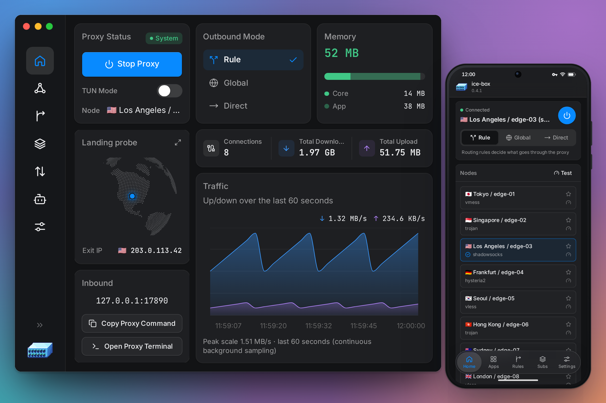

<div align="center">

<a href="https://yilong-musk.github.io/ice-box/">
  
</a>

# ice-box

**Лучший sing-box GUI.**

Лёгкий прокси-клиент для macOS, Windows, Linux и Android.<br>
Простой в настройке, быстрый при запуске, тихий в работе и дружелюбный к агентам — на базе ядра [sing-box](https://github.com/SagerNet/sing-box).

[](https://github.com/yilong-musk/ice-box/releases/latest)
[](https://github.com/yilong-musk/ice-box/actions/workflows/ci.yml)
[](https://github.com/yilong-musk/ice-box/releases)
[](#установка)
[](https://github.com/SagerNet/sing-box)
[](LICENSE)

[**Скачать**](https://github.com/yilong-musk/ice-box/releases/latest) · [**Интерактивное демо**](https://yilong-musk.github.io/ice-box/) · [Установка](#установка) · [TUN](#режим-tun) · [Документация](#документация) · [Список изменений](CHANGELOG.md)

[Bahasa Indonesia](README.id.md) · [Deutsch](README.de.md) · [English](README.md) · [Español](README.es.md) · [Français](README.fr.md) · [Português (BR)](README.pt-BR.md) · [Tiếng Việt](README.vi.md) · [Türkçe](README.tr.md)<br>**Русский** · [Українська](README.uk.md) · [العربية](README.ar.md) · [فارسی](README.fa.md) · [日本語](README.ja.md) · [한국어](README.ko.md) · [简体中文](README.zh-CN.md) · [繁體中文](README.zh-TW.md)

<br>

<a href="https://yilong-musk.github.io/ice-box/">
  
</a>

<sub><a href="https://yilong-musk.github.io/ice-box/">Интерактивное демо</a> запускает интерфейсы для ПК и Android прямо в браузере с имитацией бэкенда.</sub>

</div>

## Возможности

- **Подписки.** Автоматически распознаются sing-box JSON, Clash и списки ссылок, также можно импортировать локальный файл конфигурации sing-box. Настольная версия умеет автоматически обновлять профили; Android обновляет их при импорте или вручную. На каждой подписке отображаются трафик и срок действия от провайдера.
- **Маршрутизация.** Режимы **Правила**, **Глобальный** и **Напрямую**, отдельный переключатель для каждого правила подписки и собственные пользовательские правила поверх них.
- **Узлы.** Выбор выхода для каждой группы стратегий, проверка задержки одного узла или всего списка и закрепление избранных.
- **Подключения.** На ПК (macOS, Windows и Linux) отображается каждое активное подключение: адрес назначения, сработавшее правило, используемый выход и объём переданного трафика. Доступны поиск, сортировка и закрытие одного или всех подключений.
- **Перехват трафика.** Системный прокси или TUN на ПК; системный VPN на Android с маршрутизацией по приложениям (по правилам, прокси, напрямую или блокировка).
- **Трей.** Запускайте и останавливайте прокси-сервис, меняйте режим, подписку и выходной узел, не открывая окно. На macOS значок в строке меню также показывает текущий трафик, а в меню можно запускать проверку задержки.
- **Доступ для агентов.** Опциональный локальный сервис MCP позволяет агенту управлять той же запущенной сессией.
- **Без лишних хлопот.** Запуск при входе в систему, обновления внутри приложения с проверкой подписи, показатели трафика и памяти в реальном времени на Главной, 16 языков с полной поддержкой RTL (Bahasa Indonesia, Deutsch, English, Español, Français, Português (BR), Tiếng Việt, Türkçe, Русский, Українська, العربية, فارسی, 日本語, 한국어, 简体中文, 繁體中文), светлая и тёмная темы.

## Установка

Загрузите установщик для вашей платформы со страницы [последнего релиза](https://github.com/yilong-musk/ice-box/releases/latest).

| Платформа | Требования | Установщик | Первый запуск |
|---|---|---|---|
| **macOS** (Apple Silicon) | macOS 12 или новее | `ice-box_<version>_aarch64.dmg` | Имеет только ad-hoc подпись (без Developer ID и без нотаризации), поэтому при первом запуске появится предупреждение о **неизвестном разработчике**. Разрешите запуск в **Системные настройки → Конфиденциальность и безопасность → Всё равно открыть** (macOS 15+), через контекстное меню **Открыть** (более ранние версии) или командой `xattr -dr com.apple.quarantine /Applications/ice-box.app`. |
| **Windows** (x64) | Windows 10 или новее | `ice-box_<version>_x64-setup.exe` | Установщик NSIS для текущего пользователя; права администратора не требуются. Подпись Authenticode отсутствует, поэтому SmartScreen может запросить подтверждение. |
| **Linux** (x64 / arm64) | Ubuntu 22.04+ / современные дистрибутивы | `ice-box_<version>_amd64.AppImage` / `aarch64.AppImage`<br>`ice-box_<version>_amd64.deb` / `arm64.deb` | Сделайте AppImage исполняемым (`chmod +x`) или установите `.deb` командой `sudo apt install ./ice-box_*.deb`. Для значка в трее GNOME требуется расширение AppIndicator (`gnome-shell-extension-appindicator`). В среде Wayland + NVIDIA приложение автоматически задаёт `WEBKIT_DISABLE_DMABUF_RENDERER=1`, если переменная ещё не установлена. |
| **Android** (arm64) | Android 14 или новее | `ice-box_<version>_android_arm64.apk` | Подписан ключом проекта. Приложения нет в Google Play; Android запросит разрешение на установку из этого источника. |

**Обновление.** На macOS, Windows (0.1.5+) и в Linux AppImage приложение в фоне проверяет GitHub Releases и устанавливает обновления с проверкой подписи через **Настройки → Обновления приложения**; для более старых установок macOS/Windows сначала потребуется одно ручное обновление. Пакет `.deb` в Linux проверяет тот же каталог и открывает страницу загрузки релиза, чтобы обновлениями по-прежнему управляли `apt` / `dpkg`. На Android раздел **Настройки → Обновления приложения** скачивает arm64 APK и передаёт его системному установщику для подтверждения.

## Быстрый старт

1. **Импортируйте подписку.** Откройте **Подписки**, вставьте URL и нажмите **Импорт** — формат определится автоматически. Чтобы использовать локальный файл конфигурации sing-box (JSON), выберите **Файл конфигурации**; у него нет удалённого URL, поэтому обновлять его нельзя.
2. **Выберите режим и узел.** На вкладке **Главная** выберите **Правила**, **Глобальный** или **Напрямую**. На ПК откройте **Узлы**, чтобы выбрать выход и проверить задержку; на Android используйте список узлов на экране **Главная**.
3. **Запустите прокси-сервис.** Нажмите кнопку питания. На ПК применится системный прокси или запустится TUN (если включён); на Android подключится VPN после подтверждения системного разрешения.

Ещё нет подписки? ice-box запускается в режиме «Напрямую», так что ядро, перехват трафика и интерфейс можно опробовать ещё до импорта.

## Запуск при входе в систему

На macOS, Windows и Linux включите **Настройки → Запуск → Запускать при входе в систему**. При автозапуске приложение остаётся в трее со скрытым окном, запускает ядро и восстанавливает последнее состояние прокси.

Отключайте его тем же переключателем: отключение записи в **Объекты входа** на macOS не сбрасывает настройку в приложении. Перед включением на macOS установите приложение — запуск напрямую из образа диска отклоняется. В Linux запись создаётся в `~/.config/autostart/com.yilong-musk.icebox.desktop` (при запуске из AppImage сохраняется `$APPIMAGE`).

На Android нет объектов входа. В разделе **Настройки → Система** описаны исключение из оптимизации батареи, строгий Частный DNS и постоянный VPN.

## Режим TUN

На macOS, Windows и Linux режим TUN перехватывает трафик на сетевом уровне, охватывая приложения, которые игнорируют системный прокси. TUN в Windows поддерживает только IPv4 TCP (без UDP/QUIC и IPv6) и требует учётную запись администратора; альтернативой остаётся системный прокси. В Linux TUN использует Polkit (`pkexec`) для установки systemd-демона `ice-helper` и управляет DNS через `systemd-resolved` (`resolvectl`) или статический `/etc/resolv.conf`. Настройка, поведение переключателя, поддержка платформ и ограничения описаны в [`docs/tun.md`](docs/tun.md). Android использует системный VPN — см. [`docs/architecture.md`](docs/architecture.md#clients).

## Доступ для агентов через MCP

Настольное приложение (macOS, Windows и Linux) предоставляет опциональный локальный сервис MCP. Откройте раздел **MCP** между **Подключения** и **Настройки**, включите сервис и скопируйте сгенерированную конфигурацию клиента. Агент разделяет настройки, подписки, данные, ядро и состояние прокси текущей запущенной сессии, не создавая отдельный экземпляр.

- **Полный набор инструментов.** Статус, настройки, трафик, подписки, узлы и группы, правила, активные подключения, журналы, диагностика, управление прокси и защищённое восстановление TUN. Результаты содержат структурированные данные (когда доступны) и сохраняют коды ошибок приложения.
- **Безопасность по умолчанию.** MCP слушает только аутентифицированный loopback со случайным токеном управления, который никогда не попадает в скопированную конфигурацию клиента.
- **Встроенный stdio-мост.** Сгенерированная конфигурация запускает тот же исполняемый файл в режиме моста, поэтому отдельный демон или адаптер протокола не требуется.

MCP доступен только на ПК: на Android MCP нет, а в веб-демо используется имитация сервиса. Настройка, жизненный цикл и границы безопасности описаны в [`docs/mcp.md`](docs/mcp.md).

## Разработка

Rust (версия закреплена в `rust-toolchain.toml`, rustup установит её при первом запуске), Node.js 22, Xcode Command Line Tools на macOS и пакеты разработки GTK/WebKit (`libwebkit2gtk-4.1-dev`, `libgtk-3-dev`, `libayatana-appindicator3-dev`, `librsvg2-dev`, `libssl-dev`) на Linux. Для сборки Android также нужны JDK 17, Go и Android SDK (`ANDROID_HOME`) с пакетами, устанавливаемыми через `scripts/ci-install-android-sdk.sh`.

```bash
cd apps/desktop && npm install && cd ../..
npm run fetch-singbox   # скачать закреплённое ядро sing-box для текущей платформы
npm run dev
```

| Команда | Назначение |
|---|---|
| `npm run dev:mac-arm64` / `dev:mac-x64` / `dev:win` / `dev:linux-x64` / `dev:linux-arm64` | Запуск для конкретной целевой платформы |
| `npm run gate` | Полная проверка рабочего пространства: fmt, clippy, тесты Rust, проверка типов, сборки, smoke-тесты, fixtures |
| `npm run fetch-singbox && npm run build` | Сборка `.dmg` для macOS |
| `npm run fetch-singbox -- win && npm run build:win` | Сборка установщика NSIS для Windows |
| `npm run fetch-singbox -- linux-x64 && npm run build:linux` | Сборка `.deb` и `.AppImage` для Linux (передайте `linux-arm64` на arm64) |
| `npm run acceptance` / `acceptance:tun` / `acceptance:win` / `acceptance:linux` / `acceptance:linux-tun` | Приёмочные тесты на реальной системе |
| `bash scripts/build-android-apk.sh debug arm64` | Отладочный APK для устройства arm64 |
| `bash scripts/build-android-apk.sh debug amd64` | Отладочный APK для эмулятора |

```
apps/desktop    React UI + оболочка Tauri для macOS, Windows и Linux
apps/mobile     Оболочка Android; переиспользует настольный интерфейс
apps/website    Сайт на GitHub Pages и интерактивное демо
crates/         Рабочее пространство Rust (основные крейты): ice-app, ice-config, ice-core, ice-engine, ice-subscription, ice-proxy-sys, ice-tun-sys, ice-elevate, ice-helper, ice-types, ...
```

## Документация

| Документ | Содержание |
|---|---|
| [`docs/architecture.md`](docs/architecture.md) | Архитектура системы, зоны ответственности компонентов, потоки данных и проектные границы |
| [`docs/mcp.md`](docs/mcp.md) | Настройка MCP на ПК, модель общего рантайма, инструменты и безопасность |
| [`docs/tun.md`](docs/tun.md) | Поведение TUN, восстановление, настройка по платформам и ограничения |
| [`docs/testing.md`](docs/testing.md) | Покрытие локальных и CI-проверок, ручное тестирование на реальных устройствах |
| [`docs/release-process.md`](docs/release-process.md) | Версионирование, подпись, упаковка и публикация |
| [`CHANGELOG.md`](CHANGELOG.md) | История релизов |

Указанные технические документы в настоящее время доступны только на английском языке.

## Лицензия

ice-box — свободное программное обеспечение, распространяемое под лицензией [GNU General Public License v3.0 или более поздней версии](LICENSE). Встроенное ядро sing-box также распространяется под лицензией [GPL-3.0-or-later](third_party/sing-box/LICENSE) с ограничением upstream на использование названия; все уведомления о сторонних компонентах приведены в файле [NOTICE](NOTICE).

<div align="center">
<br>
<sub>Создано с помощью Tauri, React и sing-box.</sub>
</div>
