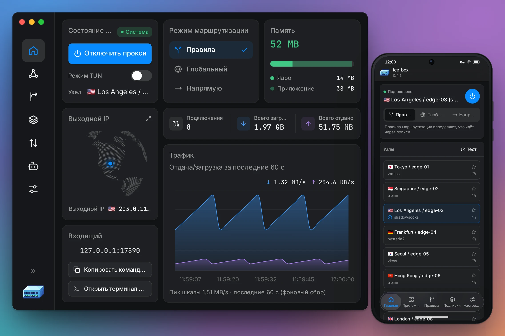

<div align="center">

<a href="https://yilong-musk.github.io/ice-box/">
  
</a>

# ice-box

**Лучший sing-box GUI.**

Лёгкий прокси-клиент для macOS, Windows, Linux и Android — на базе [sing-box](https://github.com/SagerNet/sing-box).

[](https://github.com/yilong-musk/ice-box/releases/latest)
[](https://github.com/yilong-musk/ice-box/actions/workflows/ci.yml)
[](https://github.com/yilong-musk/ice-box/releases)
[](#установка)
[](https://github.com/SagerNet/sing-box)
[](LICENSE)

[**Скачать**](https://github.com/yilong-musk/ice-box/releases/latest) · [**Интерактивное демо**](https://yilong-musk.github.io/ice-box/) · [Установка](#установка) · [Разработка](#разработка) · [Документация](#документация) · [Список изменений](CHANGELOG.md)

[Bahasa Indonesia](README.id.md) · [Deutsch](README.de.md) · [English](README.md) · [Español](README.es.md) · [Français](README.fr.md) · [Português (BR)](README.pt-BR.md) · [Tiếng Việt](README.vi.md) · [Türkçe](README.tr.md)<br>**Русский** · [Українська](README.uk.md) · [العربية](README.ar.md) · [فارسی](README.fa.md) · [日本語](README.ja.md) · [한국어](README.ko.md) · [简体中文](README.zh-CN.md) · [繁體中文](README.zh-TW.md)

<br>

<a href="https://yilong-musk.github.io/ice-box/">
  
</a>

<sub>Опробуйте интерфейсы для ПК и Android прямо в браузере в <a href="https://yilong-musk.github.io/ice-box/">Интерактивном демо</a>.</sub>

</div>

## Возможности

- **Подписки**: Автоопределение sing-box JSON, Clash, ссылок и локальных JSON-файлов; отображение трафика и срока действия; автообновление на ПК.
- **Маршрутизация и узлы**: Режимы **Правила** / **Глобальный** / **Напрямую**, переключатели для отдельных правил, свои правила, тесты задержки и избранное.
- **Перехват трафика**: Системный прокси или TUN на ПК ([`docs/tun.md`](docs/tun.md)); системный VPN с маршрутизацией по приложениям на Android.
- **Подключения и трей (ПК)**: Инспектор активных подключений с поиском, сортировкой и закрытием, а также управление из трея (скорость и тесты задержки в строке меню macOS).
- **MCP для агентов (ПК)**: Опциональный локальный аутентифицированный loopback-сервер MCP со встроенным stdio-мостом, разделяющий текущую сессию ([`docs/mcp.md`](docs/mcp.md)).
- **Основное**: Запуск при входе в систему, подписанные обновления внутри приложения, карточки трафика и памяти в реальном времени, светлая и тёмная темы, 16 языков с полной поддержкой RTL (`ar`, `fa`).

## Установка

Скачайте с [GitHub Releases](https://github.com/yilong-musk/ice-box/releases/latest):

| Платформа | Требования | Пакет | Примечания |
|---|---|---|---|
| **macOS** (Apple Silicon) | macOS 12+ | `ice-box_<version>_aarch64.dmg` | Ad-hoc подпись: разрешите в **Конфиденциальность и безопасность → Всё равно открыть** или выполните `xattr -dr com.apple.quarantine /Applications/ice-box.app`. |
| **Windows** (x64) | Windows 10+ | `ice-box_<version>_x64-setup.exe` | Установщик NSIS для текущего пользователя (без подписи; подтвердите SmartScreen). TUN поддерживает только IPv4 TCP и требует прав администратора. |
| **Linux** (x64 / arm64) | Ubuntu 22.04+ | `.AppImage` / `.deb` | `chmod +x *.AppImage` или `sudo apt install ./ice-box_*.deb`. Для трея GNOME нужен `gnome-shell-extension-appindicator`. |
| **Android** (arm64) | Android 14+ | `ice-box_<version>_android_arm64.apk` | Подписан ключом проекта; разрешите установку из этого источника. |
| **CLI** (macOS / Windows / Linux) | macOS 12+ / Win 10+ / Ubuntu 22.04+ | `ice-box-cli_<version>_<os>_<arch>.tar.gz` / `.zip` | Консольный CLI и демон со встроенным `sing-box` ([`docs/cli.md`](docs/cli.md)). |

**Установка CLI одной командой** (скачивает подходящий архив релиза и проверяет `SHA256SUMS`):

**macOS** (Apple Silicon)

```bash
curl -fsSL https://raw.githubusercontent.com/yilong-musk/ice-box/main/scripts/install-cli.sh | bash
```

**Linux** (x64 / arm64)

```bash
curl -fsSL https://raw.githubusercontent.com/yilong-musk/ice-box/main/scripts/install-cli.sh | bash
```

**Windows** (x64, PowerShell)

```powershell
irm https://raw.githubusercontent.com/yilong-musk/ice-box/main/scripts/install-cli.ps1 | iex
```

- **Быстрый старт**: Импортируйте подписку (**Подписки**) → выберите режим и узел (**Главная** / **Узлы**) → нажмите кнопку питания. Работает в режиме «Напрямую» и без подписки.
- **Обновления**: Подписанные обновления внутри приложения в **Настройки → Обновления приложения** (`.deb` открывает Releases для `apt`; Android скачивает APK для системной установки).

## Разработка

Требуются Rust (`rust-toolchain.toml`), Node.js 22, Xcode CLT (macOS) или библиотеки разработки GTK/WebKit (`libwebkit2gtk-4.1-dev`, `libgtk-3-dev`, `libayatana-appindicator3-dev`, `librsvg2-dev`, `libssl-dev`) на Linux. Для Android дополнительно нужны JDK 17, Go и `ANDROID_HOME` (`scripts/ci-install-android-sdk.sh`).

```bash
cd apps/desktop && npm install && cd ../..
npm run fetch-singbox
npm run dev
```

| Команда | Назначение |
|---|---|
| `npm run dev:mac-arm64` / `dev:mac-x64` / `dev:win` / `dev:linux-x64` / `dev:linux-arm64` | Запуск для конкретной целевой платформы |
| `npm run gate` | Полная проверка рабочего пространства (fmt, clippy, тесты Rust/фронтенда, сборки, smoke-тесты) |
| `npm run fetch-singbox && npm run build` | Сборка `.dmg` для macOS |
| `npm run fetch-singbox -- win && npm run build:win` | Сборка установщика для Windows |
| `npm run fetch-singbox -- linux-x64 && npm run build:linux` | Сборка `.deb` и `.AppImage` для Linux (`linux-arm64` на arm64) |
| `npm run acceptance` / `acceptance:tun` / `acceptance:win` / `acceptance:linux` / `acceptance:linux-tun` | Приёмочные проверки на реальной системе |
| `bash scripts/package-cli.sh` | Собрать и проверить кроссплатформенный CLI-архив для этой системы |
| `bash scripts/build-android-apk.sh debug arm64` | Сборка отладочного APK для Android (`amd64` для эмулятора) |

```text
apps/desktop    React UI + настольная оболочка Tauri (macOS, Windows, Linux)
apps/mobile     Оболочка Tauri для Android (переиспользует настольный интерфейс)
apps/website    Сайт на GitHub Pages и интерактивное демо
crates/         Рабочее пространство Rust (ice-app, ice-config, ice-core, ice-engine, ice-subscription, ice-proxy-sys, ice-tun-sys, ice-elevate, ice-helper, ice-types, ...)
```

## Документация

| Документ | Содержание |
|---|---|
| [`docs/architecture.md`](docs/architecture.md) | Архитектура, границы модулей и потоки данных |
| [`docs/cli.md`](docs/cli.md) | Кроссплатформенный CLI без GUI, демон и автоматизация агентов |
| [`docs/mcp.md`](docs/mcp.md) | Настройка MCP на ПК, инструменты и модель безопасности |
| [`docs/tun.md`](docs/tun.md) | Перехват TUN, повышение прав, восстановление и ограничения платформ |
| [`docs/testing.md`](docs/testing.md) | Локальные и CI-проверки, ручное тестирование на реальных устройствах |
| [`docs/release-process.md`](docs/release-process.md) | Версионирование, подпись, упаковка и публикация |
| [`CHANGELOG.md`](CHANGELOG.md) | История релизов |

Указанные технические документы в настоящее время доступны только на английском языке.

## Лицензия

[GPL-3.0-or-later](LICENSE). Встроенное ядро sing-box: [GPL-3.0-or-later](third_party/sing-box/LICENSE) с ограничением upstream на использование названия. Уведомления о сторонних компонентах: [NOTICE](NOTICE).

<div align="center">
<br>
<sub>Создано с помощью Tauri, React и sing-box.</sub>
</div>
