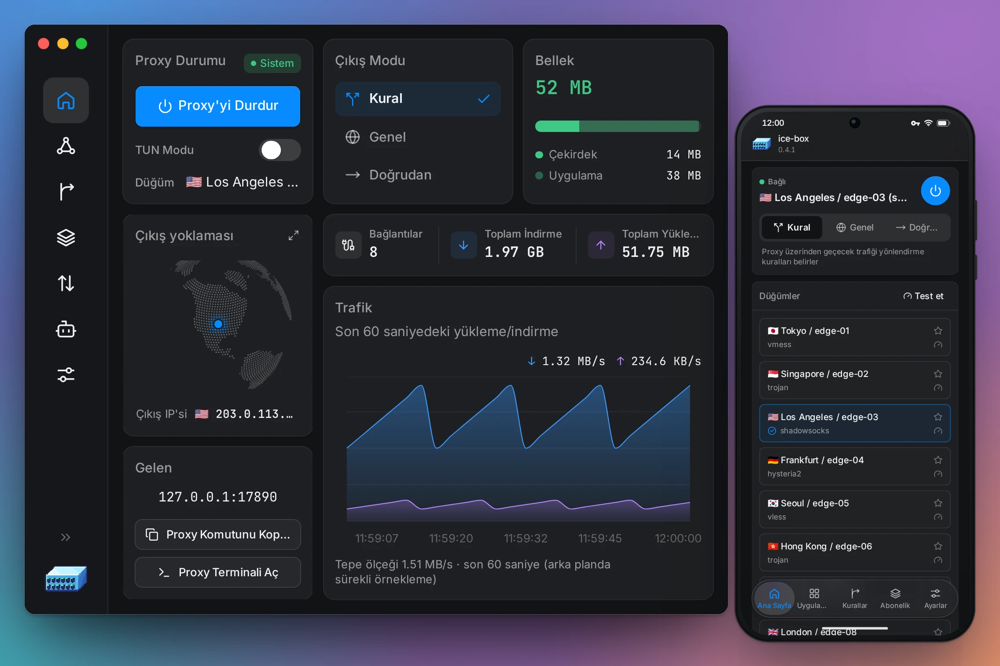

<div align="center">

<a href="https://yilong-musk.github.io/ice-box/">
  
</a>

# ice-box

**En iyi sing-box GUI.**

macOS, Windows, Linux ve Android için hafif proxy istemcisi — [sing-box](https://github.com/SagerNet/sing-box) çekirdeği üzerine kurulu.

[](https://github.com/yilong-musk/ice-box/releases/latest)
[](https://github.com/yilong-musk/ice-box/actions/workflows/ci.yml)
[](https://github.com/yilong-musk/ice-box/releases)
[](#kurulum)
[](https://github.com/SagerNet/sing-box)
[](LICENSE)

[**İndir**](https://github.com/yilong-musk/ice-box/releases/latest) · [**Canlı Demo**](https://yilong-musk.github.io/ice-box/) · [Kurulum](#kurulum) · [Geliştirme](#geliştirme) · [Belgeler](#belgeler) · [Değişiklik Günlüğü](CHANGELOG.md)

[Bahasa Indonesia](README.id.md) · [Deutsch](README.de.md) · [English](README.md) · [Español](README.es.md) · [Français](README.fr.md) · [Português (BR)](README.pt-BR.md) · [Tiếng Việt](README.vi.md) · **Türkçe**<br>[Русский](README.ru.md) · [Українська](README.uk.md) · [العربية](README.ar.md) · [فارسی](README.fa.md) · [日本語](README.ja.md) · [한국어](README.ko.md) · [简体中文](README.zh-CN.md) · [繁體中文](README.zh-TW.md)

<br>

<a href="https://yilong-musk.github.io/ice-box/">
  
</a>

<sub><a href="https://yilong-musk.github.io/ice-box/">Canlı Demo</a> ile masaüstü ve Android arayüzlerini tarayıcınızda deneyin.</sub>

</div>

## Özellikler

- **Abonelikler**: sing-box JSON, Clash, paylaşım bağlantıları ve yerel JSON dosyalarını otomatik algılar; kota/bitiş tarihi gösterimi; masaüstünde otomatik güncelleme.
- **Yönlendirme ve Düğümler**: **Kural** / **Genel** / **Doğrudan** modları, kural bazlı anahtarlar, özel kurallar, gecikme testleri ve favoriler.
- **Trafik Yakalama**: Masaüstünde sistem proxy veya TUN ([`docs/tun.md`](docs/tun.md)); Android'de uygulama bazlı yönlendirmeli sistem VPN'i.
- **Bağlantılar ve Sistem Tepsisi (Masaüstü)**: Arama/sıralama/kapatma destekli canlı bağlantı denetleyicisi ve tepsi kontrolleri (macOS menü çubuğu hız göstergesi ve gecikme testleri).
- **Agent'lar için MCP (Masaüstü)**: Canlı oturumu paylaşan yerleşik stdio köprülü, isteğe bağlı kimliği doğrulanmış yerel loopback MCP sunucusu ([`docs/mcp.md`](docs/mcp.md)).
- **Temel Özellikler**: Oturum açıldığında başlatma, imzalı uygulama içi güncellemeler, canlı trafik/bellek kartları, açık/koyu temalar ve tam RTL (`ar`, `fa`) destekli 16 dil.

## Kurulum

[GitHub Releases](https://github.com/yilong-musk/ice-box/releases/latest) üzerinden indirin:

| Platform | Gereksinim | Paket | Notlar |
|---|---|---|---|
| **macOS** (Apple Silicon) | macOS 12+ | `ice-box_<version>_aarch64.dmg` | Ad-hoc imzalı: **Gizlilik ve Güvenlik → Yine de Aç** üzerinden izin verin veya `xattr -dr com.apple.quarantine /Applications/ice-box.app` çalıştırın. |
| **Windows** (x64) | Windows 10+ | `ice-box_<version>_x64-setup.exe` | Kullanıcı bazlı NSIS yükleyicisi (imzasız; SmartScreen'i onaylayın). TUN yalnızca IPv4 TCP destekler ve Yönetici gerektirir. |
| **Linux** (x64 / arm64) | Ubuntu 22.04+ | `.AppImage` / `.deb` | `chmod +x *.AppImage` veya `sudo apt install ./ice-box_*.deb`. GNOME tepsi simgesi için `gnome-shell-extension-appindicator` gerekir. |
| **Android** (arm64) | Android 14+ | `ice-box_<version>_android_arm64.apk` | Proje anahtar deposuyla (keystore) imzalıdır; bu kaynaktan kuruluma izin verin. |
| **CLI** (macOS / Windows / Linux) | macOS 12+ / Win 10+ / Ubuntu 22.04+ | `ice-box-cli_<version>_<os>_<arch>.tar.gz` / `.zip` | Dahili `sing-box` ile arayüzsüz CLI ve arka plan servisi ([`docs/cli.md`](docs/cli.md)). |

**Tek satırda CLI kurulumu** (uygun sürüm arşivini indirir ve `SHA256SUMS` doğrular):

```bash
# macOS (arm64) / Linux (x64, arm64)
curl -fsSL https://raw.githubusercontent.com/yilong-musk/ice-box/main/scripts/install-cli.sh | bash

# Windows (x64, PowerShell)
irm https://raw.githubusercontent.com/yilong-musk/ice-box/main/scripts/install-cli.ps1 | iex
```

- **Hızlı başlangıç**: Abonelik içe aktarın (**Abonelikler**) → mod ve düğüm seçin (**Ana Sayfa** / **Düğümler**) → güç düğmesine basın. Abonelik olmadan doğrudan modda çalışır.
- **Güncellemeler**: **Ayarlar → Uygulama Güncellemeleri** üzerinden imzalı uygulama içi güncellemeler (`.deb`, `apt` için Releases sayfasını açar; Android sistem kurulumu için APK indirir).

## Geliştirme

Rust (`rust-toolchain.toml`), Node.js 22, Xcode CLT (macOS) veya Linux'ta GTK/WebKit geliştirme kütüphaneleri (`libwebkit2gtk-4.1-dev`, `libgtk-3-dev`, `libayatana-appindicator3-dev`, `librsvg2-dev`, `libssl-dev`) gerekir. Android ayrıca JDK 17, Go ve `ANDROID_HOME` (`scripts/ci-install-android-sdk.sh`) gerektirir.

```bash
cd apps/desktop && npm install && cd ../..
npm run fetch-singbox
npm run dev
```

| Komut | Amaç |
|---|---|
| `npm run dev:mac-arm64` / `dev:mac-x64` / `dev:win` / `dev:linux-x64` / `dev:linux-arm64` | Belirli bir hedef platform için çalıştır |
| `npm run gate` | Tam çalışma alanı kapısı (fmt, clippy, Rust/ön yüz testleri, derlemeler, smoke testleri) |
| `npm run fetch-singbox && npm run build` | macOS `.dmg` derle |
| `npm run fetch-singbox -- win && npm run build:win` | Windows yükleyicisini derle |
| `npm run fetch-singbox -- linux-x64 && npm run build:linux` | Linux `.deb` ve `.AppImage` derle (arm64'te `linux-arm64`) |
| `npm run acceptance` / `acceptance:tun` / `acceptance:win` / `acceptance:linux` / `acceptance:linux-tun` | Gerçek makine kabul testleri |
| `bash scripts/package-cli.sh` | Bu ana makine için çapraz platform arayüzsüz CLI arşivini derle ve doğrula |
| `bash scripts/build-android-apk.sh debug arm64` | Android hata ayıklama APK'sı derle (emülatör için `amd64`) |

```text
apps/desktop    React arayüzü + Tauri masaüstü kabuğu (macOS, Windows, Linux)
apps/mobile     Android Tauri kabuğu (masaüstü arayüzünü yeniden kullanır)
apps/website    GitHub Pages sitesi ve Canlı Demo
crates/         Rust çalışma alanı (ice-app, ice-config, ice-core, ice-engine, ice-subscription, ice-proxy-sys, ice-tun-sys, ice-elevate, ice-helper, ice-types, ...)
```

## Belgeler

| Belge | Kapsam |
|---|---|
| [`docs/architecture.md`](docs/architecture.md) | Mimari, modül sınırları ve veri akışı |
| [`docs/cli.md`](docs/cli.md) | Çapraz platform arayüzsüz CLI, arka plan servisi ve ajan otomasyonu |
| [`docs/mcp.md`](docs/mcp.md) | Masaüstü MCP kurulumu, araçlar ve güvenlik modeli |
| [`docs/tun.md`](docs/tun.md) | TUN yakalama, yetki yükseltme, kurtarma ve platform sınırlamaları |
| [`docs/testing.md`](docs/testing.md) | Yerel/CI kapıları ve manuel canlı testler |
| [`docs/release-process.md`](docs/release-process.md) | Sürümleme, imzalama, paketleme ve yayınlama |
| [`CHANGELOG.md`](CHANGELOG.md) | Sürüm geçmişi |

Yukarıdaki teknik belgeler şu anda yalnızca İngilizcedir.

## Lisans

[GPL-3.0-or-later](LICENSE). Yerleşik sing-box çekirdeği: üst akış adlandırma kısıtlamasıyla birlikte [GPL-3.0-or-later](third_party/sing-box/LICENSE). Üçüncü taraf bildirimleri: [NOTICE](NOTICE).

<div align="center">
<br>
<sub>Tauri, React ve sing-box ile geliştirilmiştir.</sub>
</div>
