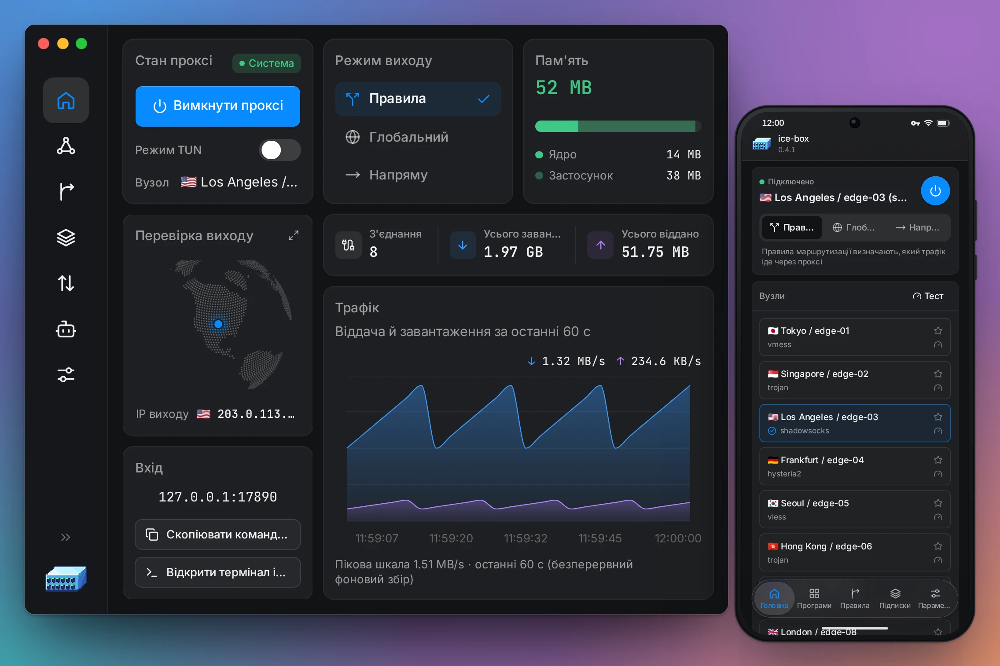

<div align="center">

<a href="https://yilong-musk.github.io/ice-box/">
  
</a>

# ice-box

**Найкращий sing-box GUI.**

Легкий проксі-клієнт для macOS, Windows, Linux і Android — на основі [sing-box](https://github.com/SagerNet/sing-box).

[](https://github.com/yilong-musk/ice-box/releases/latest)
[](https://github.com/yilong-musk/ice-box/actions/workflows/ci.yml)
[](https://github.com/yilong-musk/ice-box/releases)
[](#встановлення)
[](https://github.com/SagerNet/sing-box)
[](LICENSE)

[**Завантажити**](https://github.com/yilong-musk/ice-box/releases/latest) · [**Живе демо**](https://yilong-musk.github.io/ice-box/) · [Встановлення](#встановлення) · [Розробка](#розробка) · [Документація](#документація) · [Журнал змін](CHANGELOG.md)

[Bahasa Indonesia](README.id.md) · [Deutsch](README.de.md) · [English](README.md) · [Español](README.es.md) · [Français](README.fr.md) · [Português (BR)](README.pt-BR.md) · [Tiếng Việt](README.vi.md) · [Türkçe](README.tr.md)<br>[Русский](README.ru.md) · **Українська** · [العربية](README.ar.md) · [فارسی](README.fa.md) · [日本語](README.ja.md) · [한국어](README.ko.md) · [简体中文](README.zh-CN.md) · [繁體中文](README.zh-TW.md)

<br>

<a href="https://yilong-musk.github.io/ice-box/">
  
</a>

<sub>Спробуйте інтерфейси для десктопа та Android у браузері через <a href="https://yilong-musk.github.io/ice-box/">Живе демо</a>.</sub>

</div>

## Можливості

- **Підписки**: Автоматичне розпізнавання sing-box JSON, Clash, посилань обміну та локальних JSON-файлів; відображення квоти й терміну дії; автооновлення на десктопі.
- **Маршрутизація та вузли**: Режими **Правила** / **Глобальний** / **Напряму**, окремі перемикачі для правил, власні правила, тести затримки та вибране.
- **Перехоплення трафіку**: Системний проксі або TUN на десктопі ([`docs/tun.md`](docs/tun.md)); системний VPN із маршрутизацією для кожної програми на Android.
- **З'єднання та трей (Десктоп)**: Інспектор активних з'єднань із пошуком, сортуванням і закриттям, а також керування з трею (швидкість і тести затримки в рядку меню macOS).
- **MCP для агентів (Десктоп)**: Опціональний локальний автентифікований loopback-сервер MCP із вбудованим stdio-мостом, що спільно використовує активну сесію ([`docs/mcp.md`](docs/mcp.md)).
- **Основне**: Запуск під час входу, підписані оновлення в застосунку, картки трафіку й пам'яті в реальному часі, світла й темна теми та 16 мов із повною підтримкою RTL (`ar`, `fa`).

## Встановлення

Завантажте з [GitHub Releases](https://github.com/yilong-musk/ice-box/releases/latest):

| Платформа | Вимоги | Пакет | Примітки |
|---|---|---|---|
| **macOS** (Apple Silicon) | macOS 12+ | `ice-box_<version>_aarch64.dmg` | Ad-hoc підпис: дозвольте в **Приватність і безпека → Усе одно відкрити** або виконайте `xattr -dr com.apple.quarantine /Applications/ice-box.app`. |
| **Windows** (x64) | Windows 10+ | `ice-box_<version>_x64-setup.exe` | Інсталятор NSIS для поточного користувача (без підпису; підтвердьте SmartScreen). TUN підтримує лише IPv4 TCP і потребує прав адміністратора. |
| **Linux** (x64 / arm64) | Ubuntu 22.04+ | `.AppImage` / `.deb` | `chmod +x *.AppImage` або `sudo apt install ./ice-box_*.deb`. Для трею GNOME потрібен `gnome-shell-extension-appindicator`. |
| **Android** (arm64) | Android 14+ | `ice-box_<version>_android_arm64.apk` | Підписаний ключем проєкту; дозвольте встановлення з цього джерела. |

- **Швидкий старт**: Імпортуйте підписку (**Підписки**) → оберіть режим і вузол (**Головна** / **Вузли**) → натисніть кнопку живлення. Працює в режимі «Напряму» й без підписки.
- **Оновлення**: Підписані оновлення в застосунку через **Параметри → Оновлення застосунку** (`.deb` відкриває Releases для `apt`; Android завантажує APK для системного встановлення).

## Розробка

Потрібні Rust (`rust-toolchain.toml`), Node.js 22, Xcode CLT (macOS) або бібліотеки розробки GTK/WebKit (`libwebkit2gtk-4.1-dev`, `libgtk-3-dev`, `libayatana-appindicator3-dev`, `librsvg2-dev`, `libssl-dev`) на Linux. Для Android додатково потрібні JDK 17, Go та `ANDROID_HOME` (`scripts/ci-install-android-sdk.sh`).

```bash
cd apps/desktop && npm install && cd ../..
npm run fetch-singbox
npm run dev
```

| Команда | Призначення |
|---|---|
| `npm run dev:mac-arm64` / `dev:mac-x64` / `dev:win` / `dev:linux-x64` / `dev:linux-arm64` | Запуск для конкретної цільової платформи |
| `npm run gate` | Повна перевірка робочого простору (fmt, clippy, тести Rust/фронтенду, збірки, smoke-тести) |
| `npm run fetch-singbox && npm run build` | Збірка `.dmg` для macOS |
| `npm run fetch-singbox -- win && npm run build:win` | Збірка інсталятора для Windows |
| `npm run fetch-singbox -- linux-x64 && npm run build:linux` | Збірка `.deb` і `.AppImage` для Linux (`linux-arm64` на arm64) |
| `npm run acceptance` / `acceptance:tun` / `acceptance:win` / `acceptance:linux` / `acceptance:linux-tun` | Приймальні перевірки на реальному хості |
| `bash scripts/build-android-apk.sh debug arm64` | Збірка налагоджувального APK для Android (`amd64` для емулятора) |

```text
apps/desktop    React UI + десктопна оболонка Tauri (macOS, Windows, Linux)
apps/mobile     Оболонка Tauri для Android (повторно використовує десктопний інтерфейс)
apps/website    Сайт на GitHub Pages і живе демо
crates/         Робочий простір Rust (ice-app, ice-config, ice-core, ice-engine, ice-subscription, ice-proxy-sys, ice-tun-sys, ice-elevate, ice-helper, ice-types, ...)
```

## Документація

| Документ | Зміст |
|---|---|
| [`docs/architecture.md`](docs/architecture.md) | Архітектура, межі модулів і потоки даних |
| [`docs/mcp.md`](docs/mcp.md) | Налаштування MCP на десктопі, інструменти та модель безпеки |
| [`docs/tun.md`](docs/tun.md) | Перехоплення TUN, підвищення прав, відновлення та обмеження платформ |
| [`docs/testing.md`](docs/testing.md) | Локальні й CI-перевірки та ручні живі тести |
| [`docs/release-process.md`](docs/release-process.md) | Версіонування, підписування, пакування та публікація |
| [`CHANGELOG.md`](CHANGELOG.md) | Історія релізів |

Наведені вище технічні документи наразі доступні лише англійською мовою.

## Ліцензія

[GPL-3.0-or-later](LICENSE). Вбудоване ядро sing-box: [GPL-3.0-or-later](third_party/sing-box/LICENSE) з upstream-обмеженням щодо назви. Повідомлення щодо сторонніх компонентів: [NOTICE](NOTICE).

<div align="center">
<br>
<sub>Створено за допомогою Tauri, React і sing-box.</sub>
</div>
