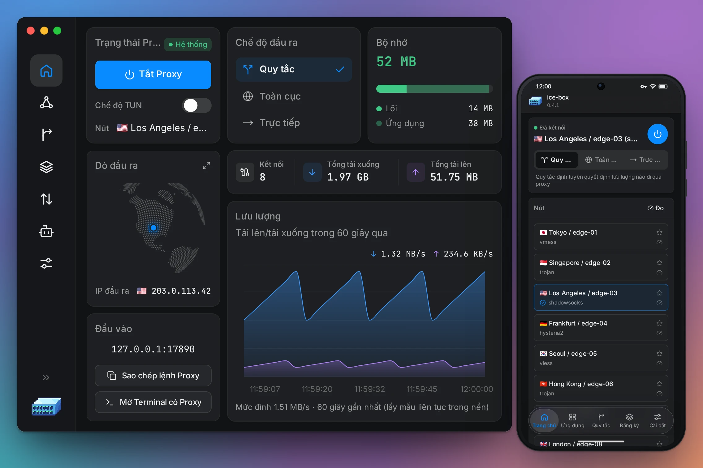

<div align="center">

<a href="https://yilong-musk.github.io/ice-box/">
  
</a>

# ice-box

**sing-box GUI tốt nhất.**

Ứng dụng proxy gọn nhẹ cho macOS, Windows, Linux và Android — xây dựng trên [sing-box](https://github.com/SagerNet/sing-box).

[](https://github.com/yilong-musk/ice-box/releases/latest)
[](https://github.com/yilong-musk/ice-box/actions/workflows/ci.yml)
[](https://github.com/yilong-musk/ice-box/releases)
[](#cài-đặt)
[](https://github.com/SagerNet/sing-box)
[](LICENSE)

[**Tải xuống**](https://github.com/yilong-musk/ice-box/releases/latest) · [**Demo trực tiếp**](https://yilong-musk.github.io/ice-box/) · [Cài đặt](#cài-đặt) · [Phát triển](#phát-triển) · [Tài liệu](#tài-liệu) · [Nhật ký thay đổi](CHANGELOG.md)

[Bahasa Indonesia](README.id.md) · [Deutsch](README.de.md) · [English](README.md) · [Español](README.es.md) · [Français](README.fr.md) · [Português (BR)](README.pt-BR.md) · **Tiếng Việt** · [Türkçe](README.tr.md)<br>[Русский](README.ru.md) · [Українська](README.uk.md) · [العربية](README.ar.md) · [فارسی](README.fa.md) · [日本語](README.ja.md) · [한국어](README.ko.md) · [简体中文](README.zh-CN.md) · [繁體中文](README.zh-TW.md)

<br>

<a href="https://yilong-musk.github.io/ice-box/">
  
</a>

<sub>Trải nghiệm giao diện máy tính và Android ngay trong trình duyệt qua <a href="https://yilong-musk.github.io/ice-box/">Demo trực tiếp</a>.</sub>

</div>

## Tính năng

- **Gói đăng ký**: Tự động nhận diện sing-box JSON, Clash, liên kết chia sẻ và tệp JSON cục bộ; hiển thị hạn mức/ngày hết hạn; tự động cập nhật trên máy tính.
- **Định tuyến & Nút**: Chế độ **Quy tắc** / **Toàn cục** / **Trực tiếp**, công tắc từng quy tắc, quy tắc tùy chỉnh, đo độ trễ và nút yêu thích.
- **Bắt lưu lượng**: Proxy hệ thống hoặc TUN trên máy tính ([`docs/tun.md`](docs/tun.md)); VPN hệ thống kèm định tuyến theo từng ứng dụng trên Android.
- **Kết nối & Khay hệ thống (Máy tính)**: Trình xem kết nối trực tiếp hỗ trợ tìm kiếm/sắp xếp/đóng, cùng điều khiển khay hệ thống (tốc độ và đo độ trễ trên thanh menu macOS).
- **MCP cho Agent (Máy tính)**: Máy chủ MCP cục bộ tùy chọn có xác thực trên loopback với cầu nối stdio tích hợp sẵn, dùng chung phiên đang chạy ([`docs/mcp.md`](docs/mcp.md)).
- **Tiện ích cốt lõi**: Khởi chạy khi đăng nhập, cập nhật trong ứng dụng có ký số, thẻ lưu lượng/bộ nhớ trực tiếp, giao diện sáng/tối và 16 ngôn ngữ hỗ trợ đầy đủ RTL (`ar`, `fa`).

## Cài đặt

Tải từ [GitHub Releases](https://github.com/yilong-musk/ice-box/releases/latest):

| Nền tảng | Yêu cầu | Gói cài đặt | Ghi chú |
|---|---|---|---|
| **macOS** (Apple Silicon) | macOS 12+ | `ice-box_<version>_aarch64.dmg` | Ký ad-hoc: cho phép trong **Quyền riêng tư & Bảo mật → Vẫn mở**, hoặc chạy `xattr -dr com.apple.quarantine /Applications/ice-box.app`. |
| **Windows** (x64) | Windows 10+ | `ice-box_<version>_x64-setup.exe` | Bộ cài NSIS theo từng người dùng (chưa ký; xác nhận SmartScreen). TUN chỉ hỗ trợ IPv4 TCP và yêu cầu quyền Quản trị viên. |
| **Linux** (x64 / arm64) | Ubuntu 22.04+ | `.AppImage` / `.deb` | `chmod +x *.AppImage` hoặc `sudo apt install ./ice-box_*.deb`. Khay hệ thống GNOME cần `gnome-shell-extension-appindicator`. |
| **Android** (arm64) | Android 14+ | `ice-box_<version>_android_arm64.apk` | Ký bằng keystore của dự án; cho phép cài đặt từ nguồn này. |

- **Bắt đầu nhanh**: Nhập gói đăng ký (**Gói đăng ký**) → chọn chế độ & nút (**Trang chủ** / **Nút**) → nhấn nút nguồn. Hoạt động ở chế độ trực tiếp khi chưa có gói đăng ký.
- **Cập nhật**: Cập nhật trong ứng dụng có ký số tại **Cài đặt → Cập nhật ứng dụng** (`.deb` mở trang Releases cho `apt`; Android tải APK để trình cài đặt hệ thống xử lý).

## Phát triển

Yêu cầu Rust (`rust-toolchain.toml`), Node.js 22, Xcode CLT (macOS) hoặc thư viện phát triển GTK/WebKit (`libwebkit2gtk-4.1-dev`, `libgtk-3-dev`, `libayatana-appindicator3-dev`, `librsvg2-dev`, `libssl-dev`) trên Linux. Android cần thêm JDK 17, Go và `ANDROID_HOME` (`scripts/ci-install-android-sdk.sh`).

```bash
cd apps/desktop && npm install && cd ../..
npm run fetch-singbox
npm run dev
```

| Lệnh | Mục đích |
|---|---|
| `npm run dev:mac-arm64` / `dev:mac-x64` / `dev:win` / `dev:linux-x64` / `dev:linux-arm64` | Chạy cho nền tảng đích cụ thể |
| `npm run gate` | Toàn bộ cổng kiểm tra workspace (fmt, clippy, kiểm thử Rust/frontend, bản dựng, smoke test) |
| `npm run fetch-singbox && npm run build` | Đóng gói `.dmg` cho macOS |
| `npm run fetch-singbox -- win && npm run build:win` | Đóng gói bộ cài Windows |
| `npm run fetch-singbox -- linux-x64 && npm run build:linux` | Đóng gói `.deb` & `.AppImage` cho Linux (`linux-arm64` trên arm64) |
| `npm run acceptance` / `acceptance:tun` / `acceptance:win` / `acceptance:linux` / `acceptance:linux-tun` | Cổng kiểm thử nghiệm thu trên máy thật |
| `bash scripts/build-android-apk.sh debug arm64` | Đóng gói APK gỡ lỗi Android (`amd64` cho trình giả lập) |

```text
apps/desktop    Giao diện React + vỏ máy tính Tauri (macOS, Windows, Linux)
apps/mobile     Vỏ Tauri Android (tái sử dụng giao diện máy tính)
apps/website    Trang GitHub Pages và Demo trực tiếp
crates/         Workspace Rust (ice-app, ice-config, ice-core, ice-engine, ice-subscription, ice-proxy-sys, ice-tun-sys, ice-elevate, ice-helper, ice-types, ...)
```

## Tài liệu

| Tài liệu | Phạm vi |
|---|---|
| [`docs/architecture.md`](docs/architecture.md) | Kiến trúc, ranh giới mô-đun và luồng dữ liệu |
| [`docs/mcp.md`](docs/mcp.md) | Thiết lập MCP trên máy tính, công cụ và mô hình bảo mật |
| [`docs/tun.md`](docs/tun.md) | Bắt lưu lượng TUN, nâng quyền, khôi phục và giới hạn nền tảng |
| [`docs/testing.md`](docs/testing.md) | Cổng kiểm tra cục bộ/CI và kiểm thử trực tiếp thủ công |
| [`docs/release-process.md`](docs/release-process.md) | Đánh phiên bản, ký số, đóng gói và phát hành |
| [`CHANGELOG.md`](CHANGELOG.md) | Lịch sử phát hành |

Các tài liệu kỹ thuật trên hiện chỉ có bằng tiếng Anh.

## Giấy phép

[GPL-3.0-or-later](LICENSE). Lõi sing-box đi kèm: [GPL-3.0-or-later](third_party/sing-box/LICENSE) kèm hạn chế đặt tên từ dự án gốc. Thông báo bên thứ ba: [NOTICE](NOTICE).

<div align="center">
<br>
<sub>Xây dựng bằng Tauri, React và sing-box.</sub>
</div>
