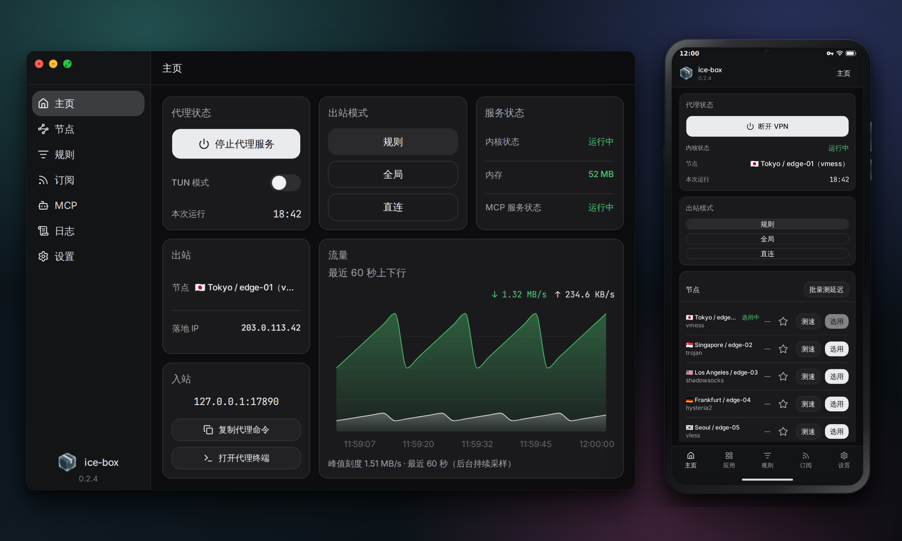

<div align="center">

<a href="https://yilong-musk.github.io/ice-box/">
  
</a>

# ice-box

**代理，保持简单。**

面向 macOS、Windows 与 Android 的轻量代理客户端。<br>
上手简单、启动迅速、运行安静，并对 Agent 友好——基于 [sing-box](https://github.com/SagerNet/sing-box) 内核。

[](https://github.com/yilong-musk/ice-box/releases/latest)
[](https://github.com/yilong-musk/ice-box/actions/workflows/ci.yml)
[](https://github.com/yilong-musk/ice-box/releases)
[](#安装)
[](https://github.com/SagerNet/sing-box)
[](LICENSE)

[**下载**](https://github.com/yilong-musk/ice-box/releases/latest) · [**在线演示**](https://yilong-musk.github.io/ice-box/) · [安装](#安装) · [TUN](#tun-模式) · [文档](#文档) · [更新日志](CHANGELOG.md)

[English](README.md) · 简体中文

<br>

<a href="https://yilong-musk.github.io/ice-box/">
  
</a>

<sub>安装前想先看看？<a href="https://yilong-musk.github.io/ice-box/">在线演示</a>在浏览器中运行桌面端与 Android 界面，后端为模拟数据。</sub>

</div>

## 安装

前往 [最新发布页](https://github.com/yilong-musk/ice-box/releases/latest) 下载对应平台的安装包。

| 平台 | 安装包 | 首次启动 |
|---|---|---|
| **macOS**（Apple Silicon） | `ice-box_<version>_aarch64.dmg` | 仅有 ad-hoc 签名（无 Developer ID、未公证），首次打开会提示「身份不明的开发者」。可在 **系统设置 → 隐私与安全性** 中点「仍要打开」（macOS 15+）、右键选择 **打开**（较早版本），或执行 `xattr -dr com.apple.quarantine /Applications/ice-box.app`。 |
| **Windows**（x64） | `ice-box_<version>_x64-setup.exe` | 按用户安装的 NSIS 安装包，无需管理员权限。安装包没有 Authenticode 签名，SmartScreen 可能会要求确认。 |
| **Android**（arm64） | `ice-box_<version>_android_arm64.apk` | 使用项目密钥签名。没有 Google Play 上架；首次安装时，Android 会要求允许从此来源安装应用。 |

**更新。** 在 macOS 与 Windows 上（0.1.5+），ice-box 会在后台检查 GitHub Releases，并在 **设置 → 应用更新** 中安装经签名校验的更新；更早版本需要先手动升级一次。在 Android 上，**设置 → 应用更新** 检查同一份目录，在应用内下载 arm64 APK，再交给系统安装器确认。

## 快速上手

1. **导入订阅。** 打开 **订阅**，粘贴链接，点击 **导入**。sing-box JSON、Clash 和分享链接列表会自动识别。桌面端可开启自动更新；Android 只在导入或手动刷新时更新订阅。机场通过列表条目或 `subscription-userinfo` 响应头上报的流量与到期信息，会汇总到订阅条目上。
2. **选择模式和节点。** 在 **主页** 选择 **规则**、**全局** 或 **直连**；桌面端打开 **节点** 选择出口并测速，Android 则使用 **主页** 上的节点列表。
3. **启动代理服务。** 按下电源键。桌面端会应用系统代理，启用 TUN 时则拉起 TUN；Android 会在系统授权后连接 VPN。

还没有订阅？ice-box 会以直连模式启动，内核、抓取方式和界面都可以先体验。

## 开机自启

在 macOS 与 Windows 上，打开 **设置 → 启动 → 开机自启**。自启时窗口不弹出，只进入托盘；内核照常启动，并恢复上次的代理状态。

自启项按用户注册——macOS 是 `~/Library/LaunchAgents` 下的 LaunchAgent plist，Windows 是 `HKCU` 下的 `Run` 项——每次启动都会重新指向当前的安装位置。macOS 13 及以上也会在 **系统设置 → 通用 → 登录项** 中显示；以应用内开关为准，在那里关闭不会清除应用内设置。直接从磁盘映像运行会被拒绝，因为该路径在重启后失效。

Android 没有登录项。**设置 → 系统** 说明电池优化豁免、严格私人 DNS，以及始终开启 VPN。

## TUN 模式

在 macOS 与 Windows 上，TUN 在网络层接管流量，不读取系统代理的应用也能覆盖。启用方式、开关行为、平台覆盖范围和限制统一见 [`docs/tun.md`](docs/tun.md)。Android 使用系统 VPN，见 [`docs/architecture.md`](docs/architecture.md#clients)。

## Agent 通过 MCP 访问

macOS 与 Windows 桌面端提供可选的本地 MCP 服务。在 **日志** 和 **设置** 上方打开 **MCP** 页面，启用服务并复制生成的客户端配置。Agent 与 GUI 共享当前会话的设置、订阅、数据、内核和代理状态，不会另起一个运行时。

- **35 个工具。** 覆盖状态、设置、流量、订阅、节点与分组、规则、日志、诊断、代理控制和受保护的 TUN 恢复；当结果为对象时附带结构化内容，并保留应用错误码。
- **安全的默认值。** MCP 仅在回环地址上监听，并要求随机控制令牌认证，且复制的客户端配置中不包含该令牌。
- **内置 stdio 桥接。** 生成的配置会以桥接模式启动同一可执行文件，无需额外的守护进程或协议适配器。

MCP 仅限桌面端：Android 不提供 MCP，网站演示使用模拟服务。设置、生命周期和安全边界详见 [`docs/mcp.md`](docs/mcp.md)。

## 开发

Rust（stable）、Node.js 22，macOS 上还需要 Xcode Command Line Tools。构建 Android 还需要 JDK 17、Go，以及已设置 `ANDROID_HOME` 的 Android SDK（包由 `scripts/ci-install-android-sdk.sh` 安装）。

```bash
cd apps/desktop && npm install && cd ../..
# 下载当前主机对应的固定版本 sing-box 内核
npm run fetch-singbox
npm run dev
```

| 命令 | 用途 |
|---|---|
| `npm run dev:mac-arm64` / `dev:mac-x64` / `dev:win` | 按指定主机目标运行 |
| `npm run gate` | 完整工作区门禁：fmt、clippy、Rust 测试、类型检查、构建、smoke 测试、fixtures |
| `npm run fetch-singbox && npm run build` | 构建 macOS `.dmg` |
| `npm run fetch-singbox -- win && npm run build:win` | 构建 Windows NSIS 安装包 |
| `npm run acceptance` / `acceptance:tun` / `acceptance:win` | 在真实主机上运行的验收门禁 |
| `bash scripts/build-android-apk.sh debug arm64` | 用于 arm64 设备的调试 APK |
| `bash scripts/build-android-apk.sh debug amd64` | 用于模拟器的调试 APK |

```
apps/desktop    macOS 与 Windows 的 React 界面 + Tauri 外壳
apps/mobile     Android 外壳，复用桌面端界面
apps/website    GitHub Pages 站点与在线演示
crates/         Rust 工作区（主要 crate）：ice-app、ice-config、ice-core、ice-engine、ice-subscription、ice-proxy-sys、ice-tun-sys、ice-elevate、ice-helper、ice-types 等
```

## 文档

| 文档 | 内容 |
|---|---|
| [`docs/architecture.md`](docs/architecture.md) | 系统结构、模块职责、数据流与设计边界 |
| [`docs/mcp.md`](docs/mcp.md) | 桌面端 MCP 设置、共享运行时、工具与安全边界 |
| [`docs/tun.md`](docs/tun.md) | TUN 行为、恢复机制、平台配置与限制 |
| [`docs/testing.md`](docs/testing.md) | 本地与 CI 门禁范围、手动实机测试 |
| [`docs/release-process.md`](docs/release-process.md) | 版本号、签名、打包与发布流水线 |
| [`CHANGELOG.md`](CHANGELOG.md) | 每个版本的变更 |

以上文档目前均为英文。

## 许可证

ice-box 是自由软件，以 [GNU 通用公共许可证第 3 版或更新版本](LICENSE) 发布。内置的 sing-box 内核同样采用 [GPL-3.0-or-later](third_party/sing-box/LICENSE)，并带有上游的命名限制条款；全部第三方声明见 [NOTICE](NOTICE)。

<div align="center">
<br>
<sub>基于 Tauri、React 与 sing-box 构建。</sub>
</div>
