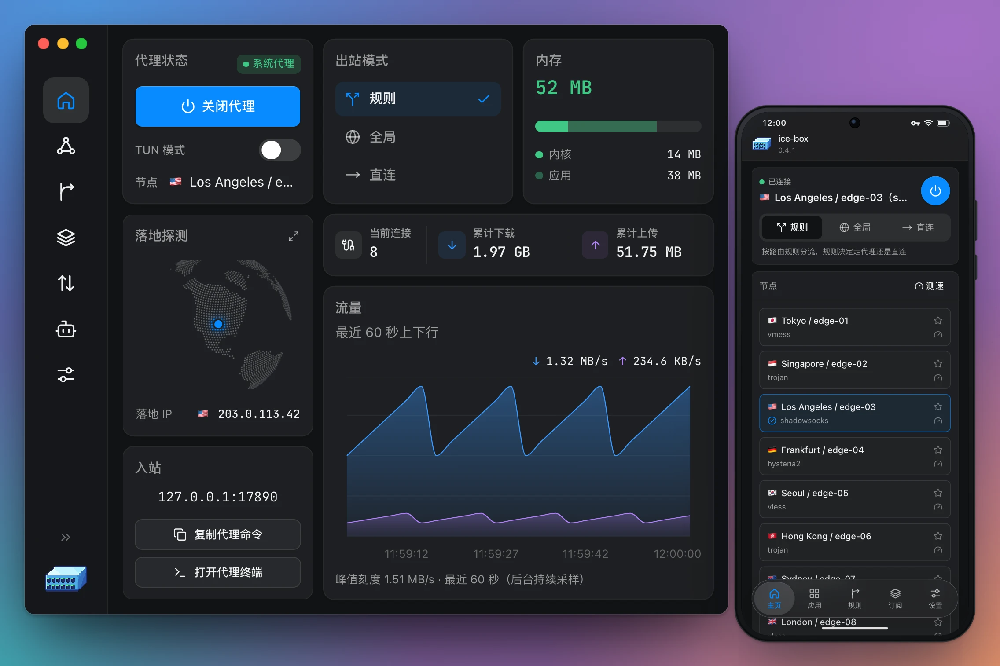

<div align="center">

<a href="https://yilong-musk.github.io/ice-box/">
  
</a>

# ice-box

**最好的 sing-box GUI。**

面向 macOS、Windows、Linux 与 Android 的轻量代理客户端——基于 [sing-box](https://github.com/SagerNet/sing-box) 内核。

[](https://github.com/yilong-musk/ice-box/releases/latest)
[](https://github.com/yilong-musk/ice-box/actions/workflows/ci.yml)
[](https://github.com/yilong-musk/ice-box/releases)
[](#安装)
[](https://github.com/SagerNet/sing-box)
[](LICENSE)

[**下载**](https://github.com/yilong-musk/ice-box/releases/latest) · [**在线演示**](https://yilong-musk.github.io/ice-box/) · [安装](#安装) · [开发](#开发) · [文档](#文档) · [更新日志](CHANGELOG.md)

[Bahasa Indonesia](README.id.md) · [Deutsch](README.de.md) · [English](README.md) · [Español](README.es.md) · [Français](README.fr.md) · [Português (BR)](README.pt-BR.md) · [Tiếng Việt](README.vi.md) · [Türkçe](README.tr.md)<br>[Русский](README.ru.md) · [Українська](README.uk.md) · [العربية](README.ar.md) · [فارسی](README.fa.md) · [日本語](README.ja.md) · [한국어](README.ko.md) · **简体中文** · [繁體中文](README.zh-TW.md)

<br>

<a href="https://yilong-musk.github.io/ice-box/">
  
</a>

<sub>通过 <a href="https://yilong-musk.github.io/ice-box/">在线演示</a> 在浏览器中体验桌面端与 Android 界面。</sub>

</div>

## 功能

- **订阅**：自动识别 sing-box JSON、Clash、分享链接及本地 JSON 配置；显示流量/到期信息；桌面端支持自动更新。
- **分流与节点**：**规则** / **全局** / **直连** 模式、订阅规则逐条开关、自定义规则、单节点/批量测速与收藏。
- **流量接管**：桌面端支持系统代理或 TUN（[`docs/tun.md`](docs/tun.md)）；Android 使用系统 VPN 并支持按应用分流。
- **连接与托盘（桌面端）**：实时连接查看（搜索/排序/关闭）与托盘控制（macOS 菜单栏实时网速及测速）。
- **Agent MCP（桌面端）**：可选本地回环鉴权 MCP 服务与内置 stdio 桥接，共享当前会话状态（[`docs/mcp.md`](docs/mcp.md)）。
- **基础体验**：开机自启、签名校验应用内更新、主页实时流量与内存读数、浅/深色主题、16 种语言（含 `ar` / `fa` 完整 RTL）。

## 安装

前往 [GitHub Releases](https://github.com/yilong-musk/ice-box/releases/latest) 下载：

| 平台 | 系统要求 | 安装包 | 说明 |
|---|---|---|---|
| **macOS**（Apple Silicon） | macOS 12+ | `ice-box_<version>_aarch64.dmg` | Ad-hoc 签名：在 **隐私与安全性 → 仍要打开** 中放行，或运行 `xattr -dr com.apple.quarantine /Applications/ice-box.app`。 |
| **Windows**（x64） | Windows 10+ | `ice-box_<version>_x64-setup.exe` | 按用户 NSIS 安装包（无签名，SmartScreen 需确认）。TUN 仅支持 IPv4 TCP 且需管理员账户。 |
| **Linux**（x64 / arm64） | Ubuntu 22.04+ | `.AppImage` / `.deb` | `chmod +x *.AppImage` 或 `sudo apt install ./ice-box_*.deb`。GNOME 托盘需安装 `gnome-shell-extension-appindicator`。 |
| **Android**（arm64） | Android 14+ | `ice-box_<version>_android_arm64.apk` | 项目密钥签名，首次安装需允许此来源。 |
| **CLI**（macOS / Windows / Linux） | macOS 12+ / Win 10+ / Ubuntu 22.04+ | `ice-box-cli_<version>_<os>_<arch>.tar.gz` / `.zip` | 内置 `sing-box` 的无头 CLI 与守护进程（[`docs/cli.md`](docs/cli.md)）。 |

**CLI 一键安装**（自动下载对应平台压缩包并校验 `SHA256SUMS`）：

```bash
# macOS (arm64) / Linux (x64, arm64)
curl -fsSL https://raw.githubusercontent.com/yilong-musk/ice-box/main/scripts/install-cli.sh | bash

# Windows (x64, PowerShell)
irm https://raw.githubusercontent.com/yilong-musk/ice-box/main/scripts/install-cli.ps1 | iex
```

- **快速上手**：在 **订阅** 导入链接 → 在 **主页** / **节点** 选择模式与节点 → 点击电源开关；无订阅时以直连模式启动。
- **更新**：在 **设置 → 应用更新** 中进行签名校验更新（`.deb` 引导至 Releases 由 `apt` 管理；Android 下载 APK 交由系统安装）。

## 开发

环境依赖：Rust（`rust-toolchain.toml`）、Node.js 22、macOS 需 Xcode CLT、Linux 需 GTK/WebKit 开发包（`libwebkit2gtk-4.1-dev`、`libgtk-3-dev`、`libayatana-appindicator3-dev`、`librsvg2-dev`、`libssl-dev`）；Android 另需 JDK 17、Go 及 `ANDROID_HOME`（`scripts/ci-install-android-sdk.sh`）。

```bash
cd apps/desktop && npm install && cd ../..
npm run fetch-singbox
npm run dev
```

| 命令 | 用途 |
|---|---|
| `npm run dev:mac-arm64` / `dev:mac-x64` / `dev:win` / `dev:linux-x64` / `dev:linux-arm64` | 指定主机目标运行 |
| `npm run gate` | 完整工作区门禁（fmt、clippy、Rust/前端测试、构建、smoke 测试） |
| `npm run fetch-singbox && npm run build` | 构建 macOS `.dmg` |
| `npm run fetch-singbox -- win && npm run build:win` | 构建 Windows 安装包 |
| `npm run fetch-singbox -- linux-x64 && npm run build:linux` | 构建 Linux `.deb` 与 `.AppImage`（arm64 使用 `linux-arm64`） |
| `npm run acceptance` / `acceptance:tun` / `acceptance:win` / `acceptance:linux` / `acceptance:linux-tun` | 真机验收门禁 |
| `bash scripts/package-cli.sh` | 构建并校验当前主机的跨平台纯 CLI 压缩包 |
| `bash scripts/build-android-apk.sh debug arm64` | 构建 Android 调试 APK（模拟器用 `amd64`） |

```text
apps/desktop    React 界面 + Tauri 桌面外壳（macOS、Windows、Linux）
apps/mobile     Android Tauri 外壳（复用桌面界面）
apps/website    GitHub Pages 站点与在线演示
crates/         Rust 工作区（ice-app、ice-config、ice-core、ice-engine、ice-subscription、ice-proxy-sys、ice-tun-sys、ice-elevate、ice-helper、ice-types 等）
```

## 文档

| 文档 | 内容 |
|---|---|
| [`docs/architecture.md`](docs/architecture.md) | 系统架构、模块边界与数据流 |
| [`docs/cli.md`](docs/cli.md) | 跨平台无头 CLI、守护进程与 Agent 自动化 |
| [`docs/mcp.md`](docs/mcp.md) | 桌面端 MCP 配置、工具集与安全模型 |
| [`docs/tun.md`](docs/tun.md) | TUN 接管、提权、恢复机制与平台限制 |
| [`docs/testing.md`](docs/testing.md) | 本地/CI 门禁与手动真机测试 |
| [`docs/release-process.md`](docs/release-process.md) | 版本号、签名、打包与发布流程 |
| [`CHANGELOG.md`](CHANGELOG.md) | 版本变更记录 |

以上技术文档目前均为英文。

## 许可证

[GPL-3.0-or-later](LICENSE)。内置 sing-box 内核同样采用 [GPL-3.0-or-later](third_party/sing-box/LICENSE)（含上游命名限制条款）。第三方声明见 [NOTICE](NOTICE)。

<div align="center">
<br>
<sub>基于 Tauri、React 与 sing-box 构建。</sub>
</div>
