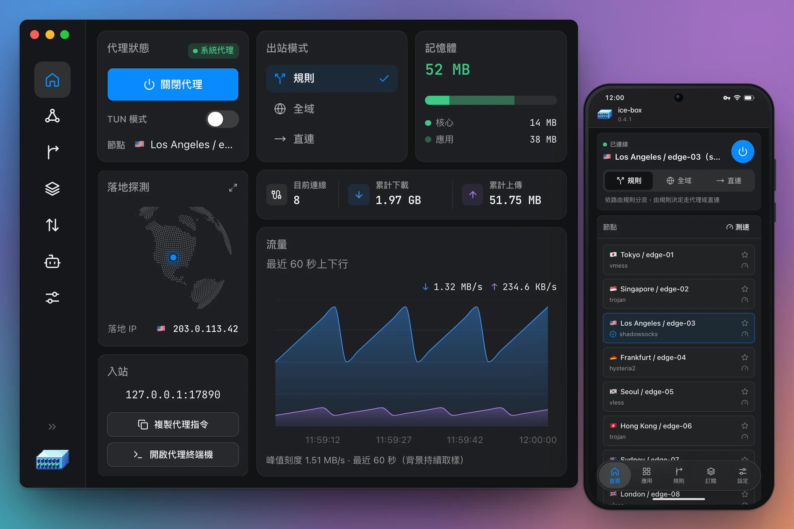

<div align="center">

<a href="https://yilong-musk.github.io/ice-box/">
  
</a>

# ice-box

**最好的 sing-box GUI。**

面向 macOS、Windows、Linux 與 Android 的輕量代理用戶端——基於 [sing-box](https://github.com/SagerNet/sing-box) 核心。

[](https://github.com/yilong-musk/ice-box/releases/latest)
[](https://github.com/yilong-musk/ice-box/actions/workflows/ci.yml)
[](https://github.com/yilong-musk/ice-box/releases)
[](#安裝)
[](https://github.com/SagerNet/sing-box)
[](LICENSE)

[**下載**](https://github.com/yilong-musk/ice-box/releases/latest) · [**即時演示**](https://yilong-musk.github.io/ice-box/) · [安裝](#安裝) · [開發](#開發) · [文件](#文件) · [更新日誌](CHANGELOG.md)

[Bahasa Indonesia](README.id.md) · [Deutsch](README.de.md) · [English](README.md) · [Español](README.es.md) · [Français](README.fr.md) · [Português (BR)](README.pt-BR.md) · [Tiếng Việt](README.vi.md) · [Türkçe](README.tr.md)<br>[Русский](README.ru.md) · [Українська](README.uk.md) · [العربية](README.ar.md) · [فارسی](README.fa.md) · [日本語](README.ja.md) · [한국어](README.ko.md) · [简体中文](README.zh-CN.md) · **繁體中文**

<br>

<a href="https://yilong-musk.github.io/ice-box/">
  
</a>

<sub>透過 <a href="https://yilong-musk.github.io/ice-box/">即時演示</a> 在瀏覽器中體驗桌面端與 Android 介面。</sub>

</div>

## 功能

- **訂閱**：自動辨識 sing-box JSON、Clash、分享連結及本機 JSON 檔案；顯示流量與到期日；桌面端支援自動更新。
- **分流與節點**：**規則** / **全域** / **直連** 模式、訂閱規則逐條開關、自訂規則、延遲測速與收藏。
- **流量接管**：桌面端支援系統代理或 TUN（[`docs/tun.md`](docs/tun.md)）；Android 使用系統 VPN 並支援依應用程式分流。
- **連線與系統匣（桌面端）**：即時連線檢視（搜尋／排序／關閉）與系統匣操作（macOS 選單列即時網速與測速）。
- **Agent MCP（桌面端）**：可選本機回環驗證 MCP 服務與內建 stdio 橋接，共用目前工作階段狀態（[`docs/mcp.md`](docs/mcp.md)）。
- **核心體驗**：登入時自動啟動、簽章驗證的應用程式內更新、首頁即時流量與記憶體卡片、淺／深色主題、16 種語言（含 `ar`、`fa` 完整 RTL）。

## 安裝

從 [GitHub Releases](https://github.com/yilong-musk/ice-box/releases/latest) 下載：

| 平台 | 系統需求 | 安裝套件 | 說明 |
|---|---|---|---|
| **macOS**（Apple Silicon） | macOS 12+ | `ice-box_<version>_aarch64.dmg` | Ad-hoc 簽章：請至 **隱私權與安全性 → 強制打開** 允許，或執行 `xattr -dr com.apple.quarantine /Applications/ice-box.app`。 |
| **Windows**（x64） | Windows 10+ | `ice-box_<version>_x64-setup.exe` | 單一使用者 NSIS 安裝程式（未簽章，需於 SmartScreen 確認）。TUN 僅支援 IPv4 TCP 且需系統管理員權限。 |
| **Linux**（x64 / arm64） | Ubuntu 22.04+ | `.AppImage` / `.deb` | `chmod +x *.AppImage` 或 `sudo apt install ./ice-box_*.deb`。GNOME 系統匣需安裝 `gnome-shell-extension-appindicator`。 |
| **Android**（arm64） | Android 14+ | `ice-box_<version>_android_arm64.apk` | 使用專案金鑰庫簽署；安裝時需允許此來源。 |

- **快速上手**：在 **訂閱** 匯入連結 → 在 **首頁** / **節點** 選擇模式與節點 → 按下電源按鈕；無訂閱時以直連模式啟動。
- **更新**：透過 **設定 → 應用程式更新** 進行簽章驗證的應用程式內更新（`.deb` 開啟 Releases 頁面由 `apt` 管理；Android 下載 APK 交由系統安裝）。

## 開發

環境需求：Rust（`rust-toolchain.toml`）、Node.js 22、Xcode CLT（macOS），或 Linux 上的 GTK/WebKit 開發套件（`libwebkit2gtk-4.1-dev`、`libgtk-3-dev`、`libayatana-appindicator3-dev`、`librsvg2-dev`、`libssl-dev`）。建置 Android 另需 JDK 17、Go 及 `ANDROID_HOME`（`scripts/ci-install-android-sdk.sh`）。

```bash
cd apps/desktop && npm install && cd ../..
npm run fetch-singbox
npm run dev
```

| 指令 | 用途 |
|---|---|
| `npm run dev:mac-arm64` / `dev:mac-x64` / `dev:win` / `dev:linux-x64` / `dev:linux-arm64` | 針對特定主機目標執行 |
| `npm run gate` | 完整工作區檢查關卡（fmt、clippy、Rust／前端測試、建置、冒煙測試） |
| `npm run fetch-singbox && npm run build` | 建置 macOS `.dmg` |
| `npm run fetch-singbox -- win && npm run build:win` | 建置 Windows 安裝程式 |
| `npm run fetch-singbox -- linux-x64 && npm run build:linux` | 建置 Linux `.deb` 與 `.AppImage`（arm64 請使用 `linux-arm64`） |
| `npm run acceptance` / `acceptance:tun` / `acceptance:win` / `acceptance:linux` / `acceptance:linux-tun` | 真實主機驗收測試 |
| `bash scripts/build-android-apk.sh debug arm64` | 建置 Android 除錯 APK（模擬器請使用 `amd64`） |

```text
apps/desktop    React 介面 + Tauri 桌面外殼（macOS、Windows、Linux）
apps/mobile     Android Tauri 外殼（共用桌面端介面）
apps/website    GitHub Pages 網站與即時演示
crates/         Rust 工作區（ice-app, ice-config, ice-core, ice-engine, ice-subscription, ice-proxy-sys, ice-tun-sys, ice-elevate, ice-helper, ice-types, ...）
```

## 文件

| 文件 | 範圍 |
|---|---|
| [`docs/architecture.md`](docs/architecture.md) | 系統架構、模組邊界與資料流 |
| [`docs/mcp.md`](docs/mcp.md) | 桌面端 MCP 設定、工具與安全模型 |
| [`docs/tun.md`](docs/tun.md) | TUN 擷取、權限提升、復原與平台限制 |
| [`docs/testing.md`](docs/testing.md) | 本機／CI 檢查關卡與手動實機測試 |
| [`docs/release-process.md`](docs/release-process.md) | 版本控管、簽章、封裝與發布 |
| [`CHANGELOG.md`](CHANGELOG.md) | 版本更新紀錄 |

以上技術文件目前皆為英文。

## 授權條款

[GPL-3.0-or-later](LICENSE)。隨附 sing-box 核心：[GPL-3.0-or-later](third_party/sing-box/LICENSE)（含上游命名限制條款）。第三方聲明：[NOTICE](NOTICE)。

<div align="center">
<br>
<sub>使用 Tauri、React 與 sing-box 建置。</sub>
</div>
