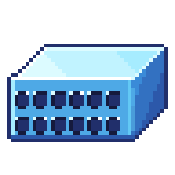
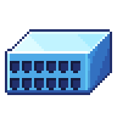
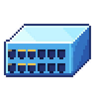
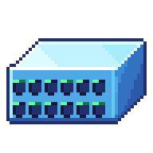
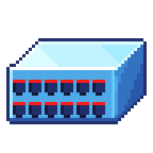
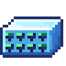
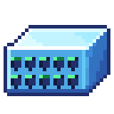

# Switch logo

A pixel-art logo for ice-box: a network switch cut from ice crystal. Its port
lights show the core state. It is drawn in code with
[pixelfx](https://github.com/patch-gg/pixelfx), in the palette and finish of
pixelfx's `ice/ice-crystal` effect.



This directory holds the source and the rendered assets. The app uses the
48 px set: the Home status logo plays the state loops, and the app icons, tray
icon, and favicon come from the plain logo. The README logo is `logo.gif`,
rendered from the `running` loop. The website brand mark plays that loop and
the phone header uses the 32 px set. The 24 and 32 px sets are redrawn on
those grids for small surfaces. `export.mjs` writes the assets here, copies
the 48 px set (and the 32 px set under `32/`) to
`apps/desktop/src/assets/switch-logo/`, writes
`apps/desktop/src-tauri/icons/tray.png` and `tray-square.png`, and refits the
Android adaptive foregrounds. The other app icons are generated with
`tauri icon` from a 1024 px nearest-neighbour upscale of `assets/logo.png`.

## Core states

Each state is a 3-second loop. The port lights change with the state; the body
keeps its ice shading, glints, cold light, and frost motes, while one glassy
sheen crosses the front per loop.

The still PNGs are flat: no glows, glints, or sheen. The strips and `logo.gif`
keep the light effects. Each still freezes a phase that shows its state:
`starting` at 0.215 (two columns lit on the 48 and 32 px grids), `stopping`
at 0.4, and the others at 0.95.

| State | Still | Port lights |
| --- | --- | --- |
| `stopped` |  | All off |
| `starting` |  | An amber light runs across the ports, left to right, twice a loop |
| `running` |  | Green link lights hold steady on every port; activity lights blink a deeper green with traffic |
| `stopping` |  | Amber lights go out column by column from the right, then all dark for a beat |
| `error` |  | Every port flashes red together |

Amber is kept for the transitions, so the running activity lights are a deeper
green, not amber. With a state, each light is two pixels wide so the state
reads at a glance; the plain 48 px logo uses one-pixel ice-blue lights. The
error red is deep enough that the glow does not wash it out pink. The 24 and
32 px variants use fewer, larger ports, with two-pixel lights on each port.

## Small sizes

The 24 and 32 px sets are not downscaled from the 48 px art: they redraw the
mark with fewer, wider ports and two-pixel lights so the state still reads at
a small size. Both cover the same five states and loop for 3 seconds; their
strips are 1080 × 24 and 1440 × 32.




## Assets

Everything under `assets/` is transparent PNG, plus 4× nearest-neighbour
copies of the stills, except the GIF noted below. The 48 px set lives at the
top level; the 24 and 32 px sets are self-contained under `states-24/` and
`states-32/`.

| File | Contents |
| --- | --- |
| `logo.png`, `logo@4x.png` | The plain 48 px logo, still |
| `logo.gif` | The 48 px `running` loop as a 288x210 px looping GIF, for surfaces that cannot run the CSS animation |
| `states/<state>.png` | The 48 px state loop as one horizontal strip: 45 frames of 48 × 48, left to right |
| `states/<state>-still.png`, `@4x` | One still frame of the 48 px state |
| `states-24/`, `states-32/` | The same set redrawn at 24 and 32 px: `logo`, `<state>`, `<state>-still` and `@4x` copies, plus a `manifest.json` |
| `manifest.json` | Frame size, frame count, fps, loop duration, and state names for the 48 px set |

`logo.gif` is written by `export.mjs` from the same `running` frames as
`states/running.png`, so it stays in sync with the art. GIF only supports
1-bit transparency, so the faint glow and frost motes are dropped; the PNG
strips keep them. Its 45 frames use a 7 cs delay, the closest GIF timing to
15 fps (a 3.15 s loop).

The strips play at 15 fps (45 frames over 3 s). In CSS, show one frame and
step the background across the strip; the 4500% background-size works at any
native size:

```css
.switch-logo {
  width: 24px;
  height: 24px;
  background: url("assets/states-24/running.png") 0 0 / 4500% 100% no-repeat;
  image-rendering: pixelated;
  animation: switch-logo 3s steps(45, jump-none) infinite;
}
@keyframes switch-logo {
  from { background-position: 0% 0; }
  to { background-position: 100% 0; }
}
```

Use the 24 and 32 px sets at their native size. For larger marks, scale the
48 px set by whole numbers (96, 144, 192 px) to keep the pixels crisp. The app
icons are downscaled from the 48 px art, and the favicon is cropped tight to
the art so a transparent icon fills as much of the tab slot as it can. At
16 px the switch still goes soft, so that size needs a hand-drawn icon.

## Regenerating

The effects are `fx/switch-logo.js` for 48 px and `fx/switch-logo-24.js` /
`fx/switch-logo-32.js` for the small sets, which share
`fx/_switch-logo-small.js`. They run inside a pixelfx checkout. The assets here
were rendered with pixelfx at commit `044e12a` (2026-11-09).

```bash
git clone https://github.com/patch-gg/pixelfx /path/to/pixelfx
cp docs/brand/switch-logo/fx/switch-logo.js \
   docs/brand/switch-logo/fx/switch-logo-24.js \
   docs/brand/switch-logo/fx/switch-logo-32.js \
   docs/brand/switch-logo/fx/_switch-logo-small.js \
   /path/to/pixelfx/src/fx/brand/
node docs/brand/switch-logo/tools/export.mjs /path/to/pixelfx
```

`export.mjs` rewrites the assets under `assets/`, including `logo.gif` and the
24 and 32 px sets. It then copies the 48 and 32 px files the app bundles into
`apps/desktop/src/assets/switch-logo/`, writes the tray bitmaps, and rewrites
`mipmap-*/ic_launcher_foreground.png` so the plain logo sits inside the 66 dp
keyline circle (1 dp of margin). Run it again after `tauri icon`, which fills
the 108 dp foreground with the whole canvas and would crop the switch under a
launcher mask. The legacy `ic_launcher.png` files stay as `tauri icon` wrote
them.

`icons/tray.png` is the plain logo cropped to its opaque pixels (44×27). macOS
draws it at 22×13.5 pt, so a 2× display maps one bitmap pixel to one device
pixel. The mark is 44×27, so a 22 pt height would be about 36 pt wide and
would scale 27 source rows onto 44 device pixels. `icons/tray-square.png` is
the same crop at 2×, letterboxed onto 88×88 for Windows and Linux, which draw
the tray icon into a square slot.

To look at an effect on its own, use pixelfx's tools from the checkout, for
example `node tools/render.mjs brand/switch-logo --opts '{"state":"running"}'
--gif` (the GIF needs ffmpeg), or `node tools/render.mjs brand/switch-logo-24
--zoom 8` for a contact sheet.

Options the 48 px effect takes (`--opts` JSON):

| Option | Default | Meaning |
| --- | --- | --- |
| `state` | `""` | `stopped`, `starting`, `running`, `stopping`, `error`, or empty for the plain logo |
| `still` | `-1` | A loop phase from 0 to 1 to freeze at, for a still frame; `-1` animates |
| `motes` | `1` | `0` turns off the frost motes (48 px only) |
| `palette` | ice-crystal ramp | Eight colors, dark to bright |
| `seed` | `21` | Each port's traffic rhythm |

The 24 and 32 px effects take the same options except `motes`; they draw no
frost motes.

## License

`fx/switch-logo.js`, `fx/switch-logo-24.js`, `fx/switch-logo-32.js`,
`fx/_switch-logo-small.js`, `tools/export.mjs` and `tools/gif.mjs` are
GPL-3.0-or-later, like the rest of ice-box. The palette, frost motes, and
glints in the switch-logo effects follow pixelfx's `ice/ice-crystal`, and the
front sheen follows `ice/ice-shatter`. Both are MIT licensed (Copyright (c) 2026
Patch, Copyright (c) 2026 Hugo Duprez). The license text is in
[`LICENSE-pixelfx.txt`](LICENSE-pixelfx.txt).
